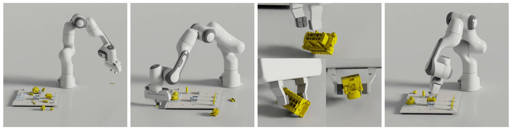
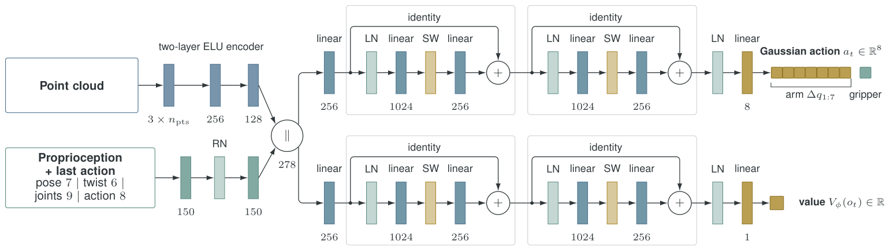
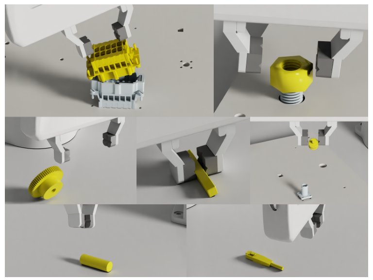

# AlphaNIST 详解教程：只有完成信号，装配技巧如何涌现？

> Octi Zhang 等，NVIDIA 与 University of Washington，*AlphaNIST: Emergent Assembly Skills from Binary Task Rewards*，arXiv:2610.13354v1，2026-10-09。[论文 PDF](../papers/alphanist-emergent-assembly-skills/paper.pdf) · [转换稿](../papers/alphanist-emergent-assembly-skills/paper.md) · [源码](../papers/alphanist-emergent-assembly-skills/paper.tex) · [项目视频](https://alpha-nist.github.io/)。arXiv 备注为“ICRA”，截至 2026-10-14 未见正式录用信息；项目页写明官方代码待发布。

## 先抓住一句话

**输入**是工件、配合几何和机器人的表面点云，加上本体状态和上一动作；**输出**是 Franka Panda 的 7 维相对关节目标增量与 1 维夹爪命令，控制频率 25 Hz。作者用一个共享策略在仿真中学习 NIST 装配板的 20 种装配，不给示范、任务阶段标签或“先抓再插”的技能序列。诀窍不是只把奖励改成 0/1，而是让机器人从大量不同起点练习，并把练习重点动态放到当前成功率中等的起点。[论文 §III–IV](../papers/alphanist-emergent-assembly-skills/paper.tex)

| 站 | 要回答的问题 | 对照材料 |
| --- | --- | --- |
| ① 动机 | 为什么过去要设计技能、分阶段、稠密奖励？ | 图 1–2，§I |
| ② 架构 | 点云和机器人状态怎样变成关节命令？ | 图 3，§IV-D |
| ③ 训练 | reset bank、beta sampling、奖励、PPO 如何配合？ | 图 4，式 3–6，算法 1 |
| ④ 数据 | 一次环境交互和一次 reset entry 是什么？ | §III–IV |
| ⑤ 信息流 | 策略执行与训练更新分别怎样循环？ | 图 3–4，算法 1 |
| ⑥ 例子 | 一根 8 mm 插销如何从拿错姿态走到插入？ | 图 8，示意数值 |
| ⑦ 实验 | 98.2% 与十件装配 84% 各是什么口径？ | 图 5–9、表 I |

## ① 动机：装配难在连续接触和长链条



图 1 展示机械臂在同一任务中选择、抓取、调整并装配多个部件。NIST Assembly Task Board #1 有 20 个装配对，既有插销与孔、齿轮与轴，也有螺母与螺栓、电连接器。小部件直径可到 4 mm，接触间隙很小；抓对物体还不够，姿态错了可能卡住，安装顺序也可能使后续部件难以接近。[论文 §I](../papers/alphanist-emergent-assembly-skills/paper.tex)

以前的常见做法是分解任务、预先摆到易抓位姿、演示抓取或为“靠近目标”“对齐”写稠密奖励。AlphaNIST 问的是：在足够多样的仿真练习下，能否只明确“最终完成装配”这个任务目标，让接触技巧和顺序自己被强化学习发现？**研究假设：**多个异构装配对共享“装配完成”目标，任务多样性反而能让策略复用接触经验。

## ② 架构：几何条件化的 actor 与 critic



从左到右看图 3：工件、配合几何和机器人表面点云是 `3×npts`；另一支是位姿 7、twist 6、关节 9、上一动作 8，共 **30 维**。点云经两层 ELU 编码到 128 维，本体分支到 150 维，拼成 278 维。actor 与 critic 有相同结构但参数独立，之后各经过投影和两个残差块；actor 输出 8 维 Gaussian 动作分布，critic 输出一个标量状态价值。论文没有写明 `npts` 的固定数值，也没有公开可核对的实现，不能补编网络采样细节。[图 3、§IV-D](../papers/alphanist-emergent-assembly-skills/figures/fig-03.png)

**策略接口**是 `a_t=[Δq₁,…,Δq₇,g]`，不是笛卡尔末端位姿。控制器按 `q_target=q_t+Δq_t` 接收前 7 维，夹爪接收 `g`；每 0.04 秒决策一次。仿真使用 7 自由度 Franka Panda、平行夹爪和硬件匹配的速度/力矩约束。策略观察几何点云，没有离散任务 ID，但点云本身会暴露当前几何，因此“没有任务 ID”不等于“不知道任务是什么”。[论文 §III、§IV-D](../papers/alphanist-emergent-assembly-skills/paper.tex)

## ③ 训练：三个部件各解决一个难题



**A. Reset bank 决定能从哪里开始。**每个缓存条目是 `(eᵢ,s̄ᵢ)`：装配对身份 `eᵢ` 选部件及其物理属性，`s̄ᵢ` 存机器人、板和工件状态。条目覆盖散落未抓、拾取、运输、接近插入和部分装配。它是**起点库**，不提供动作示范，也不给策略阶段编号。难点在于：从随机桌面开始，最初几乎碰不到完成奖励；从近完成状态起步，至少能学会最后一步，再逐渐把成功扩展回较早状态。[论文 §IV-B](../papers/alphanist-emergent-assembly-skills/paper.tex)

**B. Beta sampling 决定练哪里。**对每个 reset entry 统计最近 `L` 次从它开始的完成率 `p̂ᵢ`，抽样权重为：

```text
wᵢ = εq + √[p̂ᵢ(1−p̂ᵢ)]
qᵢ = wᵢ / Σⱼwⱼ
```

忽略共同的 `εq` 做玩具计算：`p̂=0.5` 权重 `0.5`；`p̂=0.9` 权重 `0.3`；`p̂=0` 权重 `0`。实际 `εq>0` 使零成功和全成功条目仍有机会被抽到。**这不是按任务难度手工排课程**，而是按当前策略的学习前沿分配试验次数。`L` 和 `εq` 的具体数值在论文正文未披露。[论文 §IV-B、式 4](../papers/alphanist-emergent-assembly-skills/paper.tex)

**C. 奖励决定什么算完成。**单对装配中，工件相对目标的装配误差小于 `ε=0.001 m` 时给一次 `+1` 并结束；中途靠近、抓住、对齐都没有任务进度奖励。准确说，优化使用的总奖励还扣除每步控制成本：

```text
r_success = 1[d_asm(sₜ₊₁) < 0.001 m]
rₜ = r_success − c(‖aₜ‖² + ‖q̇ₜ‖² + ‖τₜ‖²)
```

`c` 在 20 项任务间固定。这个惩罚鼓励较小动作、较低关节速度与力矩，但不指示“下一步应该朝哪里插”。因此论文所说“binary task reward”不等于每步**总**奖励严格只有 0 或 1。十对装配时，所有激活的配对都完成才给 `+1`，单独完成一对不给中间任务奖励。达到时限或速度/力矩超限也会结束回合。[论文 §IV-C、式 5–6](../papers/alphanist-emergent-assembly-skills/paper.tex)

**D. PPO 更新。**大量 Isaac Lab 仿真环境按 `qᵢ` 抽起点，共享一个 actor 和一个 critic。每次迭代每环境采 32 步，训练 5 个 epoch、每个 epoch 4 个 minibatch；多 GPU 情况平均梯度。1K–256K 并行环境的网络和 PPO 设置固定，每张 GPU 约 4K 环境。[论文算法 1、§IV-E](../papers/alphanist-emergent-assembly-skills/paper.tex)

PPO 的作用是把“某个动作之后最终成功还是失败”转为概率更新：对优势估计为正的动作提高概率，为负的动作降低概率，并用 clip 限制一次更新幅度。下面是**标准 PPO 背景公式**，论文只说明采用 standard PPO，没有给出本实验的完整优势估计和 clip 实现：

```text
ρₜ = π_new(aₜ|oₜ) / π_old(aₜ|oₜ)
L_clip = E[min(ρₜAₜ, clip(ρₜ,1−δ,1+δ)Aₜ)]
```

例如 `Aₜ=+2`、`ρₜ=1.5`、`δ=0.2`，未裁剪项为 `3`，裁剪项为 `2.4`，取较小的 `2.4`，避免一次成功轨迹把动作概率推得过快。`δ=0.2` 只是计算示意，**不是论文报告的超参数**。critic 估计的价值帮助计算 `Aₜ`，而任务成功仍由最终装配条件决定。

## ④ 数据：一次训练样本是什么

这篇不是离线模仿学习论文，训练样本由仿真 rollout 实时产生。一次 reset entry 是“任务身份 + 物理状态”，一条 PPO transition 近似是 `(oₜ,aₜ,rₜ,oₜ₊₁,done)`；实现中还要保留动作概率与价值预测以算 PPO 优势，这属于常规 PPO 数据流，**论文没有给出完整存储结构或代码**。

| 字段 | 论文中可核对的形式 | 例子 |
| --- | --- | --- |
| 任务/初始状态 | 20 个装配对之一 + 缓存的机器人/板/部件状态 | “8 mm 插销未抓，躺在板上”或“已经接近孔位”；图 4。 |
| 观察点云 | 工件、配合几何、机器人表面点，`3×npts` | 插销、孔边、夹爪的表面几何；不是 RGB 图片。 |
| 本体与历史 | 位姿 7 + twist 6 + 关节 9 + 前一动作 8 | 合计 30 维，图 3。 |
| 当前动作 | `Δq₁:₇` + 夹爪 1，8 维 | `[0.01,0,…,0,open]` 仅示意；论文未给真实动作数值或归一化细节。 |
| 反馈 | 装配完成位、控制成本、终止信号 | 接触改善但未装配完成时，`r_success=0`。 |

不要把 20 个任务误当成 20 份演示数据。论文未用动作演示，训练需要可快速复位、可计算成功条件的高吞吐仿真，以及覆盖各阶段的 reset bank。这个 reset bank 是解决稀疏奖励冷启动的关键先验。[论文 §IV](../papers/alphanist-emergent-assembly-skills/paper.tex)

## ⑤ 输入输出信息流：执行一轮，再训练一轮

```text
初始化/复位：从 reset bank 按 qᵢ 抽 (装配对 eᵢ, 初始状态 s̄ᵢ)
环境观察：点云 [3,npts] + 本体/上一动作 [30]
actor：独立点云编码 + SimBa 残差块 → Gaussian 动作 [8]
控制器：关节目标 q+Δq，夹爪命令 g → PhysX/Isaac Lab 仿真 1/25 秒
环境：新点云/本体、成功位与控制成本 → 下一步
回合结束：记录这个 reset entry 的成功/失败，更新其 p̂ᵢ 与 qᵢ
训练：收齐并行 rollout → PPO 更新共享 actor/critic → 新迭代
```

执行时策略只用当前观察和上一动作，不输入阶段编号或十件装配顺序。价值网络主要用于训练；推理控制用 actor。没有代码公开，无法进一步核对点云数量、采样策略、具体 PPO clipping 参数或精确环境张量布局。[图 3、算法 1](../papers/alphanist-emergent-assembly-skills/figures/fig-03.png)

## ⑥ 具体例子：8 mm 插销为何会“放下再抓”

论文图 8(c) 的观察：从中部夹持插销，夹爪占据了本该进入孔的杆身；策略把插销放下，在靠近一端处重新抓取，露出足够长的杆身再插入。图 8 的每个小序列从左到右是连续动作截图。[图 8](../papers/alphanist-emergent-assembly-skills/figures/fig-08.png)

用两轮闭环示意其信息流，**下列数值是讲解用示意，不是论文轨迹**：

1. **t=0：**点云显示插销横放，状态显示夹爪张开。actor 采出 8 维动作，例如第一个关节增量 `+0.01 rad`、夹爪命令维持张开。仿真走 0.04 秒，点云更新；策略继续接近并从中部抓取。
2. **t=k：**点云显示插销已被夹住，但可插入段太短。下一步策略的动作使夹爪打开并将插销放回板面；这个动作短期内没有完成奖励，甚至暂时“失去”抓取。
3. **t=k+m：**策略看到插销新姿态，转到其一端抓取，移动到孔位并插入。只有装配误差进入 1 mm 阈值时产生一次成功奖励。若这一回合失败，reset entry 的滚动成功率会更新，随后抽样权重可能变化。

关键是“放下”可能改善最终可达性；算法没有写“放下再抓”的脚本或这个阶段的专门奖励。**但这是仿真中观察到的行为，不构成真实机械臂可重复完成同样动作的证据。**十对装配的类似长程例子是图 9：先把 USB-A 移近，完成 8 mm 杆，之后回来接着装 USB-A。[图 9](../papers/alphanist-emergent-assembly-skills/figures/fig-09.png)

## ⑦ 实验：不同数字代表不同设置

| 实验 | 结果 | 必须记住的口径 |
| --- | --- | --- |
| 64K 环境、25K 迭代，20 项单对任务共享策略 | **98.2%** 训练成功率 | 对照 20 个独立稀疏奖励专家平均 81.4%；匹配每次训练运行的交互预算。图 5。 |
| 同样设置，加 reach + align 稠密项 | 共享策略 **17.8%** | 独立稠密专家平均 78.3%；只测试所选两项 shaping、系数各 0.01，不能推广为“所有稠密奖励都差”。图 5。 |
| 64K 共享稀疏策略与 20 个专家总设备时间 | 410 vs 16.1K GPU-hours | 约 39.3 倍设备时间差，非单次推理时延比较。§V-A。 |
| 环境数从 1K 到 4K 到 8K，beta sampling 的稀疏奖励评测 | 38.6% → 78.9% → 86.9% | 是固定 25K 迭代的混合 reset bank 评测，图 7。 |
| 256K 环境的 reset 抽样消融 | beta **97.4%**，uniform **84.3%** | 同一 reset bank；每任务 32 次、5 个评估 seed，图 7。 |
| 十对部件在同一回合 | **84%** | 是单独训练的十对策略，只在全部十对完成后给任务成功，表 I；没有展示一回合装完全部 20 对。 |

**局限：**所有结果都在仿真中。力矩/速度约束提高物理合理性，却不证明能应对真实点云噪声、摩擦偏差和控制延迟；十对装配和二十对单件任务也不是同一项结果。官方代码截至 2026-10-14 尚未发布，因此无法逐行核对 `PPO` 实现或复跑数值。[论文 §VI](../papers/alphanist-emergent-assembly-skills/paper.tex)、[官方项目页](https://alpha-nist.github.io/)

## 应用到我的机器人：先试能核验的最小版本

1. 选一个装配对，如 8 mm 杆入孔；先做准确的机器人/夹爪、接触、限位与成功条件仿真，并明确成功阈值和回合时限。
2. 建立覆盖桌面未抓、在手、孔前和部分插入的 reset bank，保存每个状态的物理有效性。用完成/失败而非手写进度作为主要任务信号，另保留动作、速度和力矩成本。
3. 用小规模并行 PPO 比较 uniform 与 beta reset 采样，并记录各 reset 家族的完成率，确认收益来自真正解决较早起点，而不是只在近完成状态拿高分。
4. 若准备上真机，需要深度相机或可靠点云、机械臂状态、可验证的完成传感/几何条件及硬件限位；先做低速单件验证，再测试材质、摩擦、视觉遮挡和延迟变化。

**预期收益**是减少任务专用技能脚本，并从多装配对共享接触经验；**主要风险**是仿真接触与真实世界差异、reset bank 构造成本、稀疏探索仍依赖大量并行环境，以及点云可观测性变化。论文的 410 GPU-hours 属于特定 64K 环境设置，不是小项目可直接套用的预算。

## 材料入口

- [精读笔记](../papers/alphanist-emergent-assembly-skills/精读笔记.md) · [中文分析](alphanist-emergent-assembly-skills.zh-CN.md) · [英文分析](alphanist-emergent-assembly-skills.md)
- [9 张论文图与 1 张表的索引](../papers/alphanist-emergent-assembly-skills/figures/index.md)
