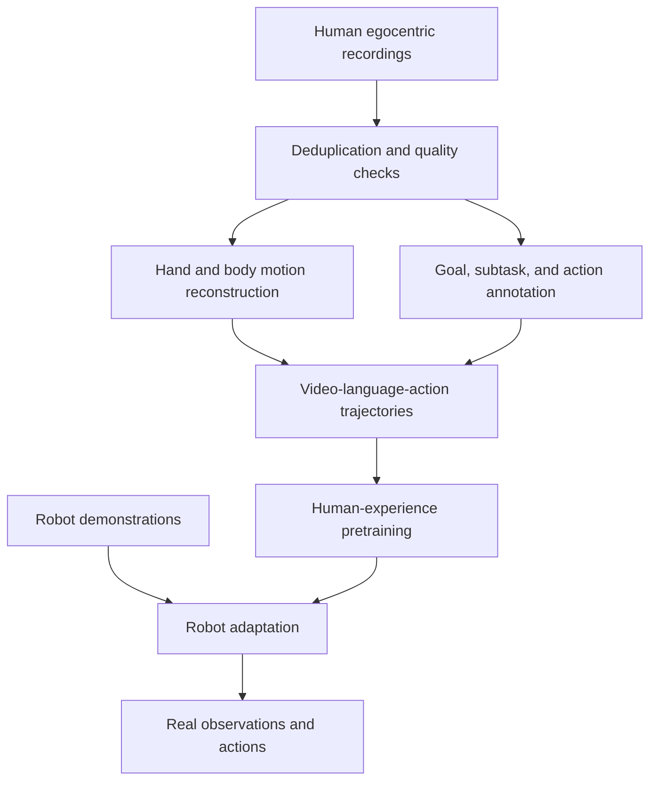

# Natura-1 Close Reading: From Human Experience to Dexterous Action

- Authors: Nature Will Team.
- Venue/year: Official technical blog, 2026; not verified as a peer-reviewed paper.
- Source: <https://www.naturewill.com/blog/natura-1?lang=en>.
- Accessed: 2026-10-22. The year comes from the page's citation; no exact publication date is inferred.
- Local source: [HTML](../papers/natura-1/source.html) · [converted Markdown](../papers/natura-1/source.md). The supplied source is HTML; no PDF link was found on the inspected page.
- Companion files: [Chinese tutorial](natura-1-close-reading.zh-CN.md) · [metadata](../data/natura-1.json) · [embedded-source manifest](../data/natura-1-embeds.json) · [scaling points](../data/natura-1-scaling.json).

The central question is how abundant human experience can become robot actions that follow instructions, handle contact, and recover from mistakes. Read Natura-1 as a proposed learning and deployment system, then ask which parts of that system the evidence actually isolates.

**Reported** means a statement in the official article or its embedded charts. **Derived** means a teaching explanation, not the disclosed implementation. **Proposed** means an experiment for your own robot. Demonstration discussions below rely on the page's descriptions and charts, not independent full-video review or experimental reproduction.

## 1. A three-pass reading plan

| Pass       | Source sections      | Question                                               | Output                                          |
| ---------- | -------------------- | ------------------------------------------------------ | ----------------------------------------------- |
| 15 minutes | §1–2 and §5          | Why human experience, and what does generality mean?   | One research hypothesis and three evidence gaps |
| 40 minutes | §4.1–4.3             | How do data, sequence learning, and serving connect?   | Training and inference information flow         |
| 35 minutes | §3 and result charts | What is generalized, tuned, measured, or demonstrated? | A controlled experiment plan                    |

Useful prerequisites are imitation learning, Transformers, and the distinction between robot observations and commands. By the end, explain why human joints cannot simply be copied, why autoregression can coexist with flow matching, and why teacher-forced prediction error is not closed-loop success.

## 2. Research question and practical bottlenecks

**Reported, §1–2:** Natura-1 is a 50B-parameter MoE model pretrained on roughly a million hours of egocentric human experience, followed by adaptation with a limited amount of robot data. It controls 20-DoF dexterous hands.

Three problems motivate this approach. First, robot collection is constrained by available hardware and executable tasks, while humans expose much broader interactions. Second, human and robot kinematics differ. Third, contact makes small errors consequential: a pose that looks plausible may tear paper, slip, or release a spring-loaded flap.

**Derived:** Continuous action dimensionality grows with joint count. An exponential count arises only after discretizing each of \(d\) joints into \(k\) choices, yielding \(k^d\) combinations. Do not read the article's exponential-space language as a claim that an action vector has exponentially many coordinates.

The key contribution is best read as an integrated route: structured human trajectories broaden coverage; joint video/action learning adds supervision; robot adaptation addresses embodiment. The public evidence does not isolate each component's causal contribution.

## 3. Data: hours of video are not hours of robot demonstrations

### 3.1 Building trajectories

**Reported, §4.1:** The corpus includes 61,702,471 episodes, 317,842 tasks, and 14,286 scenes, primarily from controlled acquisition with additional internet ego video. Processing includes deduplication, quality checks, motion reconstruction, hierarchical language annotation, and distribution management.

This is a conceptual dependency diagram, not the exact architecture or training schedule.

**Derived example:** “Place a cup in a tray” has a goal, subtasks such as grasp/transport/place, local motion, and visual consequences. A vague activity caption loses the intent-to-motion relationship; coordinates alone do not specify why the motion occurred. Hierarchical annotations can bridge those levels.

### 3.2 The embodiment gap

A generic retargeting illustration is:

\[
q^*=\arg\min_{q\in\mathcal Q}
\sum_jw_j\|f_j(q)-\tilde p_j^{human}\|^2
+\lambda\|q-q_{prev}\|^2.
\]

Here \(f_j\) is robot fingertip forward kinematics, transformed human targets are \(\tilde p_j^{human}\), and \(\mathcal Q\) contains joint and collision constraints. The second term encourages smoothness. **This is a derived teaching example, not Natura-1's disclosed objective.** Geometric agreement still does not establish appropriate contact forces or friction.

**Reported:** Motion labels reduce MPJPE by 41% relative to open-source approaches on an internal motion-capture benchmark. MPJPE measures joint position error, not force accuracy or manipulation success. Without absolute errors and detailed baselines, this cannot establish millimeter-level accuracy.

Ask whether hours mean collected, curated, or consumed training data; whether semantic variety captures contact variety; and whether train/test separation covers human pretraining as well as robot adaptation. Retrieved robot demonstrations help interpret novelty but cannot rule out all pretraining overlap.

**Proposed:** Group recordings by source, person, scene, and object instance before splitting. Deduplicate across groups so adjacent clips cannot leak into evaluation.

## 4. Model: trajectories, joint generation, and intent

### 4.1 Whole-episode supervision

**Reported, §4.3:** A standard MoE Transformer handles language, images, video, and actions. Episodes are modeled as sequences, with modality structure in layout and attention. Past video supplies memory; future video and actions are learned jointly.

A conceptual sequence is:

\[
S=[L,I_0,(V_1,A_1),\ldots,(V_T,A_T)].
\]

This is not an official token specification. It explains how supervision can cover approach, grasp, transport, and release rather than a single sampled window. Training on a full episode does not authorize conditioning a deployed action on ground-truth future frames: masks and objectives must enforce valid dependencies. The exact mask, context length, token counts, and segmentation scheme remain undisclosed.

### 4.2 Why autoregression and flow matching can coexist

Autoregression can describe dependencies across temporal blocks while a continuous block is generated through flow matching.

**Derived:** For a continuous target \(x\), noise \(\epsilon\sim\mathcal N(0,I)\), and noise time \(s\in[0,1]\), one teaching construction is:

\[
x_s=(1-s)\epsilon+sx,
\qquad
\mathcal L_{FM}=\mathbb E\|v_\theta(x_s,s,c)-(x-\epsilon)\|^2.
\]

Condition \(c\) includes permitted history and instructions. Noise time is not physical robot time. The model learns a velocity field; integrating it transports noise toward a data sample.

**Reported:** Natura-1 uses flow matching and joint denoising for video and action, with separate modality losses. A schematic \(\mathcal L=\lambda_v\mathcal L_v+\lambda_a\mathcal L_a\) is useful for reasoning, but the equation above, interpolation path, weights, sampler, and modality encoders are not disclosed recipes.

Joint prediction can learn associations between motions and visual consequences. It does not by itself establish causal physical understanding. Nor does it establish that deployed inference decodes full future videos or searches over candidate actions on every cycle.

### 4.3 Making language matter

**Reported:** The article identifies a shortcut: scenes can predict actions so well that language gets ignored. Fine-grained intent supervision is intended to make different instructions produce different futures, but the complete optimization recipe is absent.

**Derived:** If cups almost always precede cup-picking demonstrations, a policy approximating \(p(A\mid I)\) may look good while ignoring language. Test identical scenes with “put the cup in the tray,” “put it beside the tray,” and “move the tray without moving the cup.”

**Proposed:** Score object selection, spatial relation, exclusions, and order separately. Paraphrases with identical desired actions mainly test wording robustness; they do not establish semantic control of behavior.

### 4.4 What 50B does and does not specify

Total parameters do not reveal active parameters per token. Routing, precision, caching, and parallelism are needed to estimate deployment costs.

**Derived capacity check:** 50 billion weights at two bytes each require approximately 100 GB in decimal units for weights alone. This excludes caches and runtime memory and is not an official deployment specification. Quantization, sharding, and offloading change requirements.

## 5. Systems: interpreting the 100 ms budget

**Reported, §4.2:** The system targets observation-to-action latency within 100 ms using Rust orchestration, GPU-resident state, caches, execution graphs, and fused kernels. Its training configuration reports MFU above 50% and GPU utilization of 98%.

**Derived:** A 100 ms cycle suggests a roughly 10 Hz policy-loop scale, not a 10 Hz motor servo. Low-level controllers may run faster; their rate is not disclosed. Latency and update frequency are simple reciprocals only under particular scheduling assumptions.

Record exposure, reception, preprocessing completion, inference completion, command arrival, and physical execution timestamps. For overlapping pipelines, measure the critical path and observation age rather than adding all stage durations.

At an illustrative object speed of 0.2 m/s, 100 ms corresponds to 2 cm of motion. This is not a measured Natura-1 error; it explains why stale observations can dominate precision tasks.

MFU and device utilization use different denominators. A large speedup in one attention kernel is not the speedup of the complete policy. Always inspect end-to-end timing and tail latency.

## 6. Experiments: keep evidence categories separate

### 6.1 Overall score and hardware

Values below come from the [archived official benchmark chart](../assets/natura-1/score-embed.html). Percentages are benchmark scores; the inspected materials do not sufficiently define their relationship to binary task success.

| Model/mode                        | Platform          | Overall score | Mean execution time |
| --------------------------------- | ----------------- | ------------- | ------------------- |
| Natura-1 Base                     | Dexterous hands   | 53.4%         | 63.16 s             |
| Natura-1 Agentic                  | Dexterous hands   | 59.1%         | 139.31 s            |
| π0.5                              | Dual-arm grippers | 13.5%         | 289.11 s            |
| GPT-6-Astra, as named by the page | Dual-arm grippers | 16.7%         | 2,734.56 s          |

Both baselines on the dexterous platform are labeled as producing no measurable score. Do not replace that with an independently established 0% success estimate. Gripper results are supplementary comparisons with different hardware, so their gaps do not isolate architecture. Baseline names and results are attributed to the article, not independently validated here.

**Derived:** Agentic gains 5.7 percentage points while taking approximately 2.21 times the mean execution time. Its composition, number of calls, and budget are not sufficiently explained in the inspected article/charts. Do not attribute the gain to a specific search or reflection algorithm.

### 6.2 Capability breakdown

| Dimension                        | Base   | Agentic |
| -------------------------------- | ------ | ------- |
| Pose control and contact         | 56.9%  | 63.2%   |
| Bimanual coordination            | 50.0%  | 61.5%   |
| In-hand manipulation             | 16.7%  | 16.7%   |
| Tool use                         | 57.3%  | 66.7%   |
| Goal-directed reasoning          | 32.8%  | 35.4%   |
| Spatial and scene generalization | 90.9%  | 100.0%  |
| Tool and object generalization   | 100.0% | 100.0%  |
| New-action generalization        | 29.4%  | 64.3%   |
| Compositional generalization     | 73.7%  | 77.8%   |
| Planning                         | 38.5%  | 55.6%   |
| Memory                           | 57.7%  | 70.0%   |
| Recovery                         | 68.6%  | 83.3%   |

In-hand manipulation remains a visible weakness. Perfect scores on selected generalization dimensions do not establish performance on arbitrary objects. Without aggregation rules, do not average rows to reconstruct the total; without trial counts, do not manufacture confidence intervals.

### 6.3 Tuned workflows

**Reported, §3.2:** Six workflows—wonton preparation, box packing, tea serving, calligraphy, screen-protector application, and yogurt-bowl preparation—use additional task-specific tuning. They demonstrate depth of adapted behavior, not universal zero-shot execution by unchanged weights.

**Proposed viewing exercise:** For box packing, record whether the flap springs open, tape adheres, the other hand still supports the box, and cutting displaces it. These contact states turn an impressive clip into measurable events. A continuous take establishes continuity of that demonstration, not the failure denominator across attempts.

### 6.4 Zero-shot and emergence

**Reported, §3.1 and §3.3–3.4:** The article describes held-out combinations, constraint following, disturbances, and unplanned behaviors, with related robot training examples for comparison.

Define zero-shot relative to a data stage. No task-specific robot tuning does not mean no robot adaptation or no similar human pretraining experience. Emergent-behavior examples motivate hypotheses; establishing emergence with scale requires repeated evaluation across model/data sizes and an explicit criterion.

## 7. Scaling curves and teacher forcing

The [archived scaling chart](../assets/natura-1/scaling-embed.html) contains eight checkpoints per curve; HTML point attributes are preserved in [JSON](../data/natura-1-scaling.json).

| Validation set | Metric     | Reported relative reduction |
| -------------- | ---------- | --------------------------- |
| Human          | Action MSE | 47.7%                       |
| Human          | Action MAE | 37.3%                       |
| Robot          | Action MSE | 67.7%                       |
| Robot          | Action MAE | 49.3%                       |

**Reported, §4.3:** Training experience spans approximately 44,000 to one million hours. Evaluation uses teacher forcing, and robot validation does not involve additional training for that evaluation.

**Derived:** Recorded histories keep evaluation on demonstrated states. In deployment, a small action error can move an object into a different state, changing all later observations. Lower teacher-forced error is useful prediction evidence but cannot replace closed-loop measurement.

The chart's robot-MSE fit is \(E(D)=1.7193D^{-0.3893}\), with \(D\) in hours. If conditions and the fitted relationship remain applicable, doubling data multiplies error by \(2^{-0.3893}\approx0.763\), a 23.7% reduction. This is arithmetic interpretation, not a forecast of future scaling or task success.

The curves do not separately control data, compute, training stage, and sampling distribution. Error normalization and action units are also required before comparing raw MSE with other systems or interpreting it as physical distance.

## 8. Reproduction limits and useful ablations

The inspected page did not provide a paper PDF, code, weights, or full configuration link. This is a page-scoped finding, not an exhaustive claim about every possible release.

| Missing detail                                           | Why it matters                               |
| -------------------------------------------------------- | -------------------------------------------- |
| Robot-data quantity, action interface, adaptation recipe | Quantifying demonstration savings            |
| Expert routing, active size, training budget             | Reproducing compute efficiency               |
| Tokenizers, masks, denoising schedule                    | Reconstructing the actual algorithm          |
| Agentic configuration, scoring rules, trial counts       | Separating algorithm, budget, and randomness |
| Sensors and low-level control                            | Translating contact performance to hardware  |
| Failures, latency quantiles, distribution shifts         | Assessing operational reliability            |

**Proposed ablations:** Hold embodiment, test split, and robot demonstration budget fixed. Start with an available robot policy; add visual history; add identical-scene instruction contrasts; introduce human pretraining while recording its extra compute; then compare an added future-visual objective with action-only training. Run additional compute-matched controls so increased training is not mistaken for a data-type advantage.

Measure task completion, constraint satisfaction, collisions/drops, time, interventions, and P50/P95/P99 latency. Preserve every trial. Test whether video supervision helps without assuming that full video decoding must occur during deployment.

## 9. Self-check with answers

1. **Why are human hours not robot-demo hours?** Motion is reconstructed from human recordings; embodiment adaptation is a separate step.
2. **Why is video prediction not automatically physical understanding?** Statistical prediction does not ensure correct responses to unseen interventions.
3. **How would you test “do not move the cup”?** Keep the initial scene fixed, vary permission to move it, and measure violations.
4. **Is 59.1% an arbitrary-task success rate?** No; it is a score under the reported benchmark's scope and scoring rules.
5. **Which figures expose a tradeoff?** Agentic improves the score by 5.7 points but takes about 2.21 times the mean duration.
6. **Does 100 ms establish stable contact?** No; sensing age, feedback, low-level control, actuators, and motion speed also matter.
7. **What would you request from the authors first?** Robot-data scale, Agentic configuration, scoring protocol, failure statistics, and action/sensor interfaces.

## Application to My Robot

**Integration idea:** No user-specific robot configuration is available, so assume a tabletop arm with cameras and a trainable policy. Transfer temporal history, hierarchical intent annotation, and evaluation methodology first. Consider dexterous hardware only when the task requires in-hand changes, palm support, or multiple contacts; grippers can already test language and temporal hypotheses.

**Sensors and compute:** Log timestamped RGB, joint state, issued commands, and execution. Wrist views may help occlusion; force/tactile feedback may help pressure and slip tasks, but is not asserted as a disclosed Natura-1 input. Profile an accessible smaller policy on existing GPUs. Public parameter count is insufficient for a reliable Natura-1 deployment bill of materials.

**First experiment:** Use lightweight dry-object sorting. Contrast left-first/right-first, in/beside, and move/do-not-move instructions. Split by object instance and layout, fix attempts per condition, retain failures, and add modest target displacement. Add history and instruction-contrast data separately to measure their closed-loop effects.

**Expected benefit:** Reduced phase ambiguity, more consistent constraint following, and a measurable test of whether human pretraining reduces robot demonstration requirements. These are hypotheses, not guarantees from the article.

**Risks and acceptance:** Reconstruction bias, frame mismatch, and timestamp errors can become contact failures. Auxiliary visual learning may consume compute without improving control. Require locally chosen success and constraint thresholds, P95 observation-to-command latency within the robot budget, and no increase in drops, collisions, or interventions before expanding the system.
