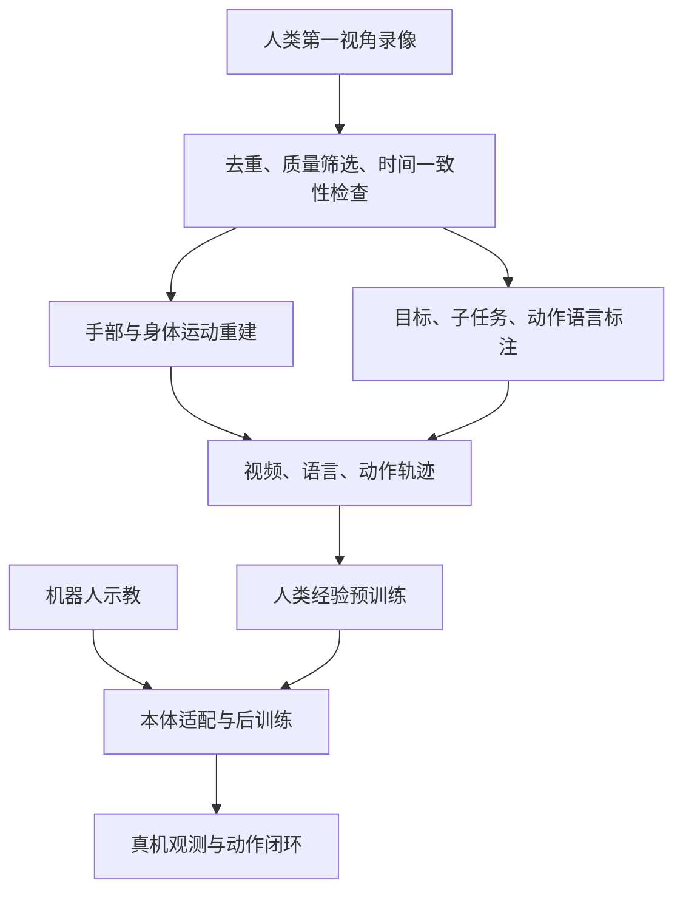

# Natura-1 精读教程：从人类经验到灵巧操作

- 作者：Nature Will Team。
- 会议/年份：官方技术博客，2026；不是已核实的同行评审论文。
- 来源：https://www.naturewill.com/blog/natura-1?lang=en
- 核验日期：2026-10-22；年份来自网页引用条目，未据此推断具体发布日期。
- 本地原文：[HTML](../papers/natura-1/source.html) · [转换 Markdown](../papers/natura-1/source.md)。原始来源为网页，本次检查页面未找到 PDF 链接。
- 配套材料：[英文教程](natura-1-close-reading.md) · [元数据](../data/natura-1.json) · [图表来源清单](../data/natura-1-embeds.json) · [缩放曲线数据](../data/natura-1-scaling.json)。

本文围绕一个问题展开：**海量人类视频怎样变成机器人能执行、能纠错、听得懂指令的灵巧操作？** Natura-1 提出的路线是扩大人类经验预训练，再用机器人数据完成本体适配。精读时既要理解这条路线的技术价值，也要判断公开材料实际支持到哪一步。

本文使用三种标记：**【披露】**表示官方正文或内嵌图表陈述；**【推导】**表示帮助理解的一般数学解释，不是官方实现；**【建议】**表示可自行设计的实验。所有演示分析依据网页文字与图表，不声称已独立检查完整视频或复现实验。

## 1. 阅读路线与学习目标

建议分三遍，合计约 90 分钟。

| 轮次            | 原文位置         | 要解决的问题                             | 阅读产物                     |
| --------------- | ---------------- | ---------------------------------------- | ---------------------------- |
| 第一遍，15 分钟 | §1–2、§5         | 为什么从人类经验出发？“通用”具体指什么？ | 一句话研究假设、三项证据缺口 |
| 第二遍，40 分钟 | §4.1–4.3         | 数据、序列模型、训练与部署怎样衔接？     | 自己画出训练和推理信息流     |
| 第三遍，35 分钟 | §3、两个结果图表 | 泛化、专项微调、性能和延迟各如何评价？   | 一份控制变量实验方案         |

需要的基础是模仿学习、Transformer、机器人观测与动作。不了解 flow matching 也可以继续，第 4 节从噪声到动作解释它。读完应能说明：人类动作标签为什么不能直接下发；自回归与联合去噪为什么并不矛盾；为什么老师强制下的误差不能代表真实闭环成功率。

## 2. 研究问题：真正难的是迁移和接触

【披露，原文 §1–2】Natura-1 是 50B 参数 MoE 模型，使用百万小时量级的第一视角人类经验预训练，再以有限机器人数据后训练，驱动 20-DoF 灵巧手。官方将数据、模型和实时系统共同视为扩大能力的基础。

先把“大模型控制手”拆成三个问题。

1. **经验覆盖：** 机器人采集只能覆盖已有设备、场景和可执行任务；人类能提供更广的物体、工具、接触和任务组合。
2. **跨本体迁移：** 人手骨长、关节轴和运动范围不同于机器手，视频恢复的运动也不直接包含机器人关节目标。
3. **闭环接触：** 接近物体时位置误差可能尚可容忍；夹取薄纸、抵住弹性盒盖时，微小误差会改变接触状态和任务可行性。

【推导】自由度增长首先意味着连续动作向量维度增加。若每个关节粗分为 \(k\) 档，\(d\) 个关节的离散组合才是 \(k^d\)。不要把原文的“指数增长”误读成连续策略输出维度本身是指数级。

关键创新更适合概括为**一条完整学习路线**：结构化人类轨迹扩大经验覆盖；统一视频与动作建模提高每条轨迹的监督密度；机器人后训练处理落地差异。公开材料尚不能把最终提升精确归因于其中某一个模块。

## 3. 数据精读：一百万小时不是一百万小时机器人示教

### 3.1 从视频到可训练轨迹

【披露，原文 §4.1】数据包含 61,702,471 个 episode、317,842 类任务、14,286 个场景，主要来自受控采集，并补充互联网第一视角视频。处理包括跨来源去重、质量检查、手部和身体运动重建、分层语言标注及分布管理。

图仅表示文章披露的概念依赖，不规定具体 token 排列、运动表示或训练阶段数。

【推导】以“把杯子放进托盘”为自拟例子，监督可分为：

| 层次     | 示例                     | 解决什么问题             |
| -------- | ------------------------ | ------------------------ |
| 目标     | 把杯子放进托盘           | 定义终止条件             |
| 子任务   | 抓杯、搬运、放置         | 标识任务阶段             |
| 局部动作 | 靠近杯身、闭合手指、抬腕 | 提供运动对应关系         |
| 连续视觉 | 接触前后图像变化         | 表示物体、遮挡和动作后果 |

只有“有人在桌边操作”的描述很容易让语言失效；只有坐标轨迹又无法说明为什么要这么移动。分层标注的价值是让意图和时序都有监督。

### 3.2 为什么不能直接复制人手关节角

【推导】一种通用重定向示意是：

\[
q^* = \arg\min_{q\in\mathcal Q}
\sum_j w_j\|f_j(q)-\tilde p_j^{human}\|^2
+\lambda\|q-q_{prev}\|^2.
\]

\(f_j(q)\) 是机器人指尖的正运动学，\(\tilde p_j^{human}\) 是经过尺度和坐标变换的人类目标，\(\mathcal Q\) 表示关节和碰撞约束。第二项鼓励时间平滑。**这是解释跨本体问题的例子，官方没有公开采用这一目标。**

即使几何位置拟合正确，也不保证接触力、摩擦和物体稳定性正确。机器人后训练可能承担这类差异的适配，但原文没有给出可复现的接口、动作编码或机器人数据量。

【披露】运动标签在内部动捕真值基准上，相比开源方法的 MPJPE 降低 41%。【推导】它衡量关节点位置误差，不是接触力误差或任务成功率；缺少绝对误差、对比方法与详细设置时，不能推出毫米级精度。

### 3.3 精读追问

- 百万小时是原始采集量、筛选后的时长，还是训练重复消费量？文章不同段落用了不同概括，复现需要统一口径。
- 任务类别多，是否意味着罕见接触方式也多？语义类别数不能替代接触覆盖。
- 展示最近邻训练演示能帮助理解差异，但不能排除全部人类预训练数据中的重合。
- 对自有数据，先按来源、操作者、场景和物体实例分组，再去重与划分，避免相邻剪辑跨越训练和测试集合。

## 4. 模型精读：整条轨迹、共同状态与语言条件

### 4.1 把时间组织起来

【披露，原文 §4.3】模型以标准 MoE Transformer 统一语言、图像、视频、动作，按整个 episode 的序列学习；模态差异主要体现在序列布局和注意力模式。历史视频提供记忆，未来视频与动作进行联合训练。

【推导】可用下面的示意序列理解“整个 episode”：

\[
S=[L,I_0,(V_1,A_1),\ldots,(V_T,A_T)].
\]

它表达“指令—初始条件—随时间推进的视觉与动作”，不是官方 token 格式。整段监督可以同时利用接近、抓住、搬运、放下等阶段；孤立窗口可能很难分辨“准备抓”与“刚放完”。

训练时给整段数据不等于策略可以偷看真实未来。合法的条件关系必须由注意力掩码和训练目标控制。原文未公开完整掩码、上下文长度、切片方法和视频 token 数，无法据此重建训练实现。

### 4.2 自回归与 flow matching 为什么不矛盾

自回归可用于描述时间块之间的条件依赖；一个未来块里的连续视频和动作变量仍可通过 flow matching 生成。二者处于不同层次。

【推导】令 \(x\) 表示某个模态的真实连续目标，\(\epsilon\sim\mathcal N(0,I)\)，用噪声时间 \(s\in[0,1]\) 定义：

\[
x_s=(1-s)\epsilon+sx,
\qquad
\mathcal L_{FM}=\mathbb E\|v_\theta(x_s,s,c)-(x-\epsilon)\|^2.
\]

这里 \(c\) 是指令和允许使用的历史条件，\(s\) 不是机器人运动时间。模型学习把噪声推向数据的速度场，推理时从噪声积分到目标分布。

【披露】官方说视频与动作使用 flow matching、联合去噪，并分别定义损失。【推导】可以抽象写成 \(\mathcal L=\lambda_v\mathcal L_v+\lambda_a\mathcal L_a\)，但上面的线性路径、权重和共享条件只是教学形式。具体噪声调度、视频编码器、采样步数、损失定义并未公开。

**重要边界：** 联合预测可能学到动作与视觉结果的统计关联；它不自动证明模型学会了可干预的物理因果规律，也不证明部署时每一步都显式生成完整未来视频、搜索并比较候选动作。

### 4.3 语言为什么容易被忽略

【披露】原文专门指出，场景可能已足以预测下一步，模型因此可能弱化语言；训练设计强调细粒度意图对预测未来的影响，但没有给出完整优化配方。

【推导】设训练集里桌上出现杯子时几乎总是“拿起杯子”，模型即使近似学习 \(p(A\mid I)\)，也能获得较低损失，却不能区分：

- 把杯子放进托盘。
- 把杯子放在托盘旁边。
- 移动托盘，但不要动杯子。

【建议】固定视觉初态，仅改变指令；同时统计目标对象、空间关系、禁选条件和执行顺序。只更换语言措辞、但期望动作不变，测到的主要是改写鲁棒性，不能证明语义控制能力。

### 4.4 MoE 的 50B 应该怎样理解

50B 是公开的模型参数规模，不能等同于每 token 激活参数量。没有专家数、top-k 路由、精度、缓存和并行配置，无法推算实际吞吐与显存配置。

【推导】若粗略假设 50B 权重全部用 2 字节保存，仅权重约占 100 GB（十进制），还未包括缓存与运行时内存。这只是容量量级计算，不是官方部署规格；量化、分片和卸载会改变要求。

## 5. 系统精读：100 ms 是什么预算

【披露，原文 §4.2】官方报告观测到动作的端到端延迟在 100 ms 内，使用 Rust 编排、GPU 常驻状态、缓存、执行图和融合算子。训练配置报告 MFU 超过 50%、GPU utilization 达到 98%。

【推导】100 ms 对应约 10 Hz 的策略循环量级，不代表手指电机伺服只运行在 10 Hz。低层控制可以更快，原文未披露其频率。推理延迟和策略更新频率也只有在特定串行调度下才简单互为倒数。

对自己的系统应记录：相机曝光时间、接收时间、预处理完成时间、推理完成时间、动作到达时间与实际执行时间。存在重叠流水线时，应计算依赖路径与观测年龄，不能直接把所有模块耗时相加。

【推导】目标以 0.2 m/s 移动，100 ms 内会移动 2 cm。此算例说明：对接触操作而言，减少观测过期和估计运动可能比增加参数更直接。它不是 Natura-1 的实测误差。

MFU 衡量模型有效浮点计算与参考峰值的关系；GPU utilization 常反映设备忙碌程度。两者分母不同。某个 attention kernel 的倍数提升也不能直接当作整个策略推理的倍数提升，应检查完整端到端路径。

## 6. 实验精读：分开评价四类证据

### 6.1 基准分数与平台差异

以下数值来自[官方内嵌基准图的本地副本](../assets/natura-1/score-embed.html)，图中总分以百分数显示；**公开页面未充分定义它与二值任务成功率的关系**。

| 模型/模式                 | 执行平台 | 总分  | 平均执行时间 |
| ------------------------- | -------- | ----- | ------------ |
| Natura-1 Base             | 灵巧手   | 53.4% | 63.16 s      |
| Natura-1 Agentic          | 灵巧手   | 59.1% | 139.31 s     |
| π0.5                      | 双臂夹爪 | 13.5% | 289.11 s     |
| GPT-6-Astra，网页所列名称 | 双臂夹爪 | 16.7% | 2,734.56 s   |

同一灵巧手平台上的两个基线被图表标为“无可测得分”，不要自行写成经过完整统计的 0% 成功率。夹爪上的结果是补充比较，不能把差值全部归因于模型架构。模型名与结果均为文章报告，本教程未独立核验基线实现。

【推导】Agentic 相比 Base 增加 5.7 个百分点，平均时间约为 2.21 倍。正文和已查图表没有充分解释 Agentic 的组成、调用次数和预算。因此不能把提升直接归因于某种搜索、反思或重规划算法。

### 6.2 按维度看，而不是只看总分

| 维度           | Base   | Agentic | 精读重点                   |
| -------------- | ------ | ------- | -------------------------- |
| 姿态与接触     | 56.9%  | 63.2%   | 精细接触还有显著余地       |
| 双手协调       | 50.0%  | 61.5%   | 需要分清时序和物理协调     |
| 手内操作       | 16.7%  | 16.7%   | 相同低分提示明显短板       |
| 工具使用       | 57.3%  | 66.7%   | 不只检查是否拿住工具       |
| 目标导向推理   | 32.8%  | 35.4%   | 高层约束仍可能困难         |
| 空间与场景泛化 | 90.9%  | 100.0%  | 满分不代表任意新场景       |
| 工具与物体泛化 | 100.0% | 100.0%  | 需要样本数与覆盖范围       |
| 新动作泛化     | 29.4%  | 64.3%   | 大幅差异需要额外预算解释   |
| 组合泛化       | 73.7%  | 77.8%   | 原子技能和组合分别留出     |
| 规划           | 38.5%  | 55.6%   | 检查预算是否匹配           |
| 记忆           | 57.7%  | 70.0%   | 需要排除当前画面已泄露答案 |
| 恢复           | 68.6%  | 83.3%   | 恢复是否以更多时间换得     |

这些是图中的维度得分，不能在不知道权重和样本构成时直接平均来还原总分。没有次数和方差，也不能根据百分数自行反推可靠置信区间。

### 6.3 六个长时程工作流需要额外微调

【披露，原文 §3.2】包馄饨、包装快递盒、泡茶、书法、贴膜、制作酸奶碗这六个演示使用任务专项微调。它们支持“适配后能持续完成复杂操作”的案例证据，不支持“同一组完全未经任务调优的权重零样本完成全部任务”。

【建议】精看包装盒任务时记录四个状态：盒盖是否弹开、胶带是否粘住、另一只手是否仍在支撑、切断后盒子是否移动。由此把“成功视频”转换成可测量的接触状态序列。单镜头证明展示过程连续，不能给出未展示尝试的失败分母。

### 6.4 零样本与涌现的边界

【披露，原文 §3.1、§3.3–3.4】文章展示训练之外的任务组合、约束指令、扰动适应和未预设的行为，并提供相近机器人训练演示用于对照。

“零样本”必须写清相对于哪个数据阶段。没有对评测任务做机器人专项微调，不等于没有机器人后训练，也不等于从未在人类视频中看到类似行为。“涌现”案例值得提出假设，但要证明能力随规模出现，还需要多规模模型、重复测试和明确判据。

## 7. 缩放曲线：先读评估协议，再读斜率

[官方曲线副本](../assets/natura-1/scaling-embed.html)提供每条曲线 8 个检查点，已把 HTML 中的点数据提取到[JSON](../data/natura-1-scaling.json)。

| 验证集 | 指标       | 官方报告的相对下降 |
| ------ | ---------- | ------------------ |
| 人类   | Action MSE | 47.7%              |
| 人类   | Action MAE | 37.3%              |
| 机器人 | Action MSE | 67.7%              |
| 机器人 | Action MAE | 49.3%              |

【披露，原文 §4.3】横轴从约 4.4 万到 100 万小时，评估采用 teacher forcing；机器人验证对相应权重没有再做额外训练。

【推导】teacher forcing 在记录的历史观测上评估预测；真实部署中，自己的动作会改变下一时刻状态。预测略有偏差可能把物体推到训练轨迹之外，后续误差因此扩大。离线 MSE 降低是有价值的预测证据，但不能替代闭环评估。

图中机器人 MSE 的拟合为 \(E(D)=1.7193D^{-0.3893}\)，\(D\) 以小时计。【推导】在相同条件且拟合仍适用时，数据翻倍的误差倍率是 \(2^{-0.3893}\approx0.763\)，约下降 23.7%。这只是区间内趋势的算术解释，不是对未来数据规模或机器人成功率的承诺。

曲线没有单独控制数据时长、训练计算量、阶段和采样分布，不能仅据此确定因果贡献。动作归一化和单位也影响 MSE 的意义，不能将图中数值直接解释为米、弧度或与其他模型的误差比较。

## 8. 复现边界与最有价值的消融

本次检查的页面未提供论文 PDF、代码、权重或完整训练配置入口。此结论限于已查页面，不能扩大为“全网绝无发布”。博客足以提出和讨论技术假设，尚不足以精确复现 Natura-1。

| 缺少的信息                         | 影响                                 |
| ---------------------------------- | ------------------------------------ |
| 机器人示教量、动作接口、后训练配方 | 无法量化人类预训练节省多少机器人数据 |
| 专家路由、激活参数、训练预算       | 无法复现算力效率和模型规模比较       |
| tokenizer、注意力掩码、去噪步数    | 无法实现相同模型与推理过程           |
| Agentic 定义、基准规则、重复次数   | 无法隔离算法收益、时间预算和随机性   |
| 相机、触觉或力觉配置、低层控制     | 无法把精细接触表现映射到自有硬件     |
| 失败日志、延迟分位数、分布外数据   | 无法判断长期部署可靠性               |

【建议】采用同一本体、同一测试划分和相同机器人示教预算，依次验证：

1. **基线：** 当前可用的机器人策略。
2. **历史消融：** 加历史视觉，与基线比较阶段误判和恢复。
3. **语言消融：** 加同场景不同指令的数据，测关系、否定和顺序。
4. **人类预训练消融：** 在明确记录额外计算量后加入人类数据，测达到同等成功率所需机器人示教量。
5. **联合目标消融：** 固定其余设置，加未来视觉辅助目标，测收益和推理成本；不要默认必须在部署时解码完整视频。

另做计算量匹配的对照，避免把额外训练预算的作用全部归于数据类型。每项记录任务成功、约束满足、碰撞或掉落、完成时间、干预次数、延迟 P50/P95/P99，并保留所有尝试。

## 9. 自测题与参考答案

1. **为什么“百万小时”不等于百万小时机器人动作？** 主要来源是人类第一视角经验，运动经过重建，机器人适配是后续阶段。
2. **为什么视频预测可能有用却不等于物理理解？** 它提供密集时间监督，但相关性预测不保证对未见干预具有正确因果响应。
3. **怎样检查模型是否听懂“不要动杯子”？** 固定初态，改变杯子是否允许移动的指令，统计违约率，而非仅看最终布局。
4. **59.1% 能否写成任意任务成功率？** 不能，它是该基准的总分，需明确评分和分母。
5. **哪组数字最能提醒你关注代价？** Agentic 的总分上升 5.7 个百分点，平均执行时间约增至 2.21 倍。
6. **为什么 100 ms 不能证明接触稳定？** 它只描述某段时延；稳定性还取决于观测年龄、控制器、接触反馈、执行器动态和任务速度。
7. **最该向作者追问什么？** 机器人数据量、Agentic 配置、评分协议、闭环失败统计，以及可复现的动作和传感器接口。

## 应用到我的机器人

**集成思路：** 当前没有用户机器人配置，先假定已有桌面机械臂、相机和可训练策略。优先迁移历史条件、分层语言与数据划分方法。只有当任务确实需要手内换握、掌部支撑或多点接触时，再用同任务评估灵巧手的硬件收益；已有夹爪也可以先验证语言和时序假设。

**传感器与算力：** 最少需要带时间戳的 RGB 图像、关节状态、下发动作和执行日志；腕部视角可减少遮挡。若任务依赖压力或滑移，评估增加力/触觉反馈，但不要把它说成官方已经披露的输入。先用现有 GPU 测小模型的吞吐和延迟，无法根据公开 50B 参数量给出可靠的 Natura-1 采购清单。

**建议首个实验：** 选择无液体的轻物体整理，设置“先左后右／先右后左”“放进／放旁边”“移动某个／不要移动某个”等指令。按物体实例和布局划分测试集，固定每种设置的尝试数，保存失败录像；再加入目标轻微位移，观察纠错。逐项加入历史和语言对照训练，测量相对基线的真实闭环收益。

**预期收益：** 减少阶段混淆、提高约束指令一致性，并检验人类经验是否能降低所需机器人示教量。这些是待验证目标，不是由文章数字保证的结果。

**风险与验收：** 运动重建偏差、坐标错配和时间不同步可能放大到接触失败；视频辅助任务也可能消耗算力却不提高操作。上线前要求目标成功率与约束满足率达到自定门槛，P95 观测到动作延迟满足本机预算，并且掉落、碰撞和人工接管没有增加。以这些指标决定下一步投资，而不是仅凭模型规模或展示视频。
