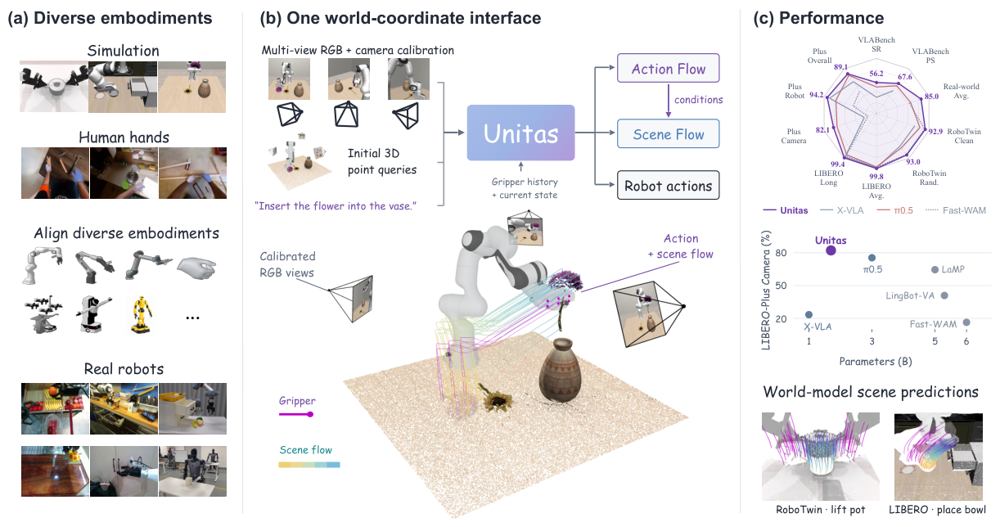
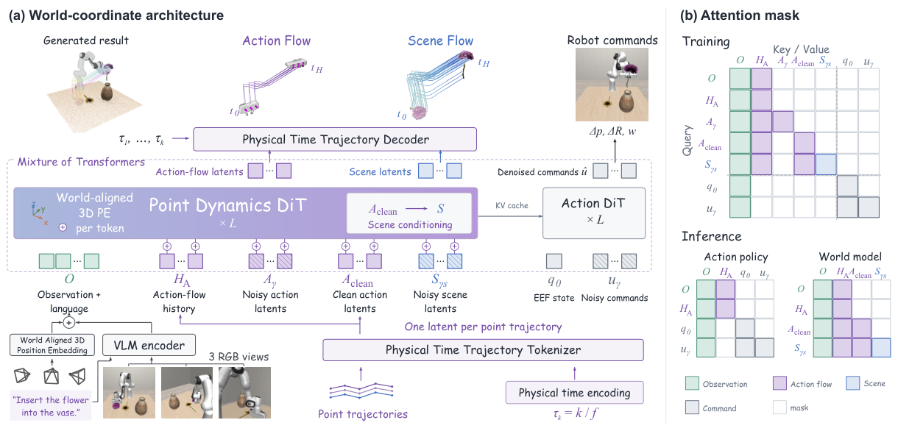
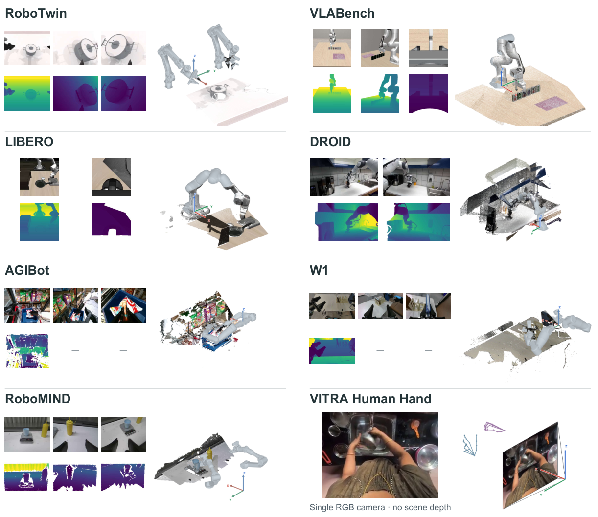
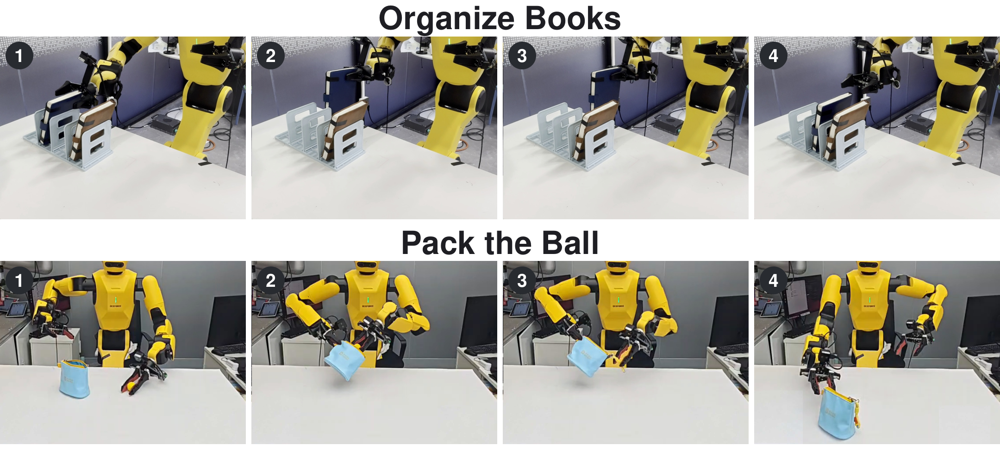
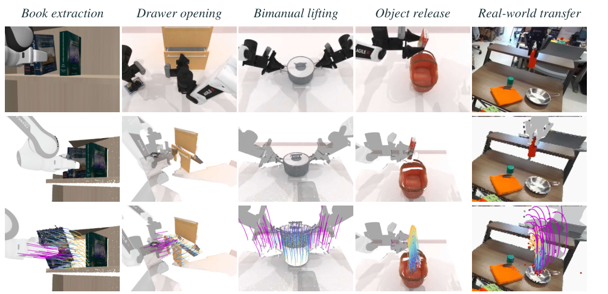

# UNITAS 详解教程：把机器人动作和场景变化放进同一个三维坐标系

> Ruixiang Wang、Yongyi Su 等，*UNITAS: A 3D-Native World Action Model for Embodied Manipulation*，arXiv:2610.12099v1，2026-10-08，27 页，预印本，仍在审稿。作者来自 CUHK-SZ、DexForce、佛山大学、中山大学、华南理工大学等。依据[原始 PDF](../papers/unitas-3d-native-world-action-model/paper.pdf)、[LaTeX 正文](../papers/unitas-3d-native-world-action-model/paper.tex)、[官方仓库](https://github.com/DexForce/UNITAS)；核对日期 2026-10-14。论文首页的 ICLR 2027 模板不是录用证明。

## 先用一句话理解

给定任务文字、当前多视角图像、相机标定和机器人状态，UNITAS 输出未来末端执行器动作块；需要预测世界时，还能输出夹爪或手部三维点轨迹，以及**以给定动作轨迹为条件**的场景点轨迹。它把这些位置和位移放在每个交互窗口内固定的米制三维坐标系中，避免只靠二维像素来表达“离目标还有几厘米”。

官方仓库已公开模型权重、推理和评测代码；其 release status 明确标示**训练代码与训练数据尚未公开**。因此可以研究公开推理链和运行给定权重，暂不能凭仓库完整复现论文的 200K 步混合数据预训练。[官方 README](https://github.com/DexForce/UNITAS)

## 导读地图

| 站 | 要回答的问题 | 依据 |
| --- | --- | --- |
| ① 动机 | 为什么动作、观测、世界变化都要用同一 3D 度量帧？ | 图 1、§1 |
| ② 架构 | VLM、点动力学专家和动作专家怎样互通？ | 图 2、§3 |
| ③ 训练 | 轨迹 tokenizer、flow matching 和四项损失各学什么？ | §3、附录 A |
| ④ 数据 | 一条样本有哪些字段、坐标与时间单位？ | 图 3、图 6、附录 A |
| ⑤ 信息流 | 推理时哪些分支运行，场景预测何时调用？ | §3、官方 `decoder.py` |
| ⑥ 实例 | “把球装入袋并拉上拉链”如何走两轮？ | 图 4、官方 `policy.py`；数值示意 |
| ⑦ 实验 | 99.8%、85% 与场景预测误差各代表什么？ | 表 1–4、附录 |

## ① 动机：二维像素难表达接触所需的尺度

机械臂把球塞进袋口时，“画面上相差 20 像素”既可能是两厘米，也可能是二十厘米，取决于视角和深度。视频式世界模型能生成未来画面，但像素或视觉 latent 不是机器人控制器直接使用的米制几何量。UNITAS 的押注是让视觉 token、夹爪运动和物体运动共享一个三维度量帧，并把不同机器人的夹爪、人手都转为点轨迹。这样同一网络可学习“手往哪里走”和“物体会怎么动”。[论文 §1、图 1](../papers/unitas-3d-native-world-action-model/paper.tex)



图 1 左侧列出仿真、真人手和真机的输入；中间展示夹爪轨迹与场景轨迹对齐到同一窗口坐标系；右侧是策略和世界预测任务。**“同一坐标系”是每个预测窗口内固定的坐标系**，并不是九个数据集拥有完全相同的全局原点。

## ② 架构：两种点轨迹，一段可执行动作

先看接口。`C` 包含指令、多视角 RGB（可带深度）、每路相机内外参和历史夹爪轨迹；`q₀` 是当前末端状态。模型给出 `A`（夹爪/人手的未来点轨迹）、`u`（机器人可执行的末端动作块）和 `S`（场景点未来轨迹）。论文的联合分解是：

```text
p(A,u,S | C,q₀) = p(A | C) · p(u | C,q₀) · p(S | A,C)
```

因此 `A` 与 `u` 可以同时生成，`S` 要在动作点轨迹给定后生成。这里的“动作流”不是最终控制指令；`u` 才进入控制接口。世界预测还可用外部给定的 `A` 做反事实或评测条件预测。[论文 §3.1](../papers/unitas-3d-native-world-action-model/paper.tex)



图 2 左侧：图像与语言先进入 Florence-2-large；视觉 token 加入世界坐标位置编码；历史轨迹和将要去噪的点轨迹交给 point dynamics DiT；较小的 action DiT 读取观测/语言的 KV 与当前末端状态，输出控制动作。右侧的注意力矩阵限制了信息泄漏：场景分支看**干净的动作点轨迹**，控制分支不能看未来动作流/场景流。这解释了为何推理可以分模式运行。

| 模块 | 规模 | 输入 → 输出 | 关键作用 |
| --- | ---: | --- | --- |
| Florence-2-large VLM | 570.7M | RGB、指令 → 视觉/语言 token | 语义与多视角视觉编码 |
| Point dynamics DiT | 826.3M；28 层、宽 1280 | 观测、历史、带噪点轨迹 → 轨迹速度 | 学动作流和动作条件场景流 |
| Action expert DiT | 256.0M；28 层、宽 640 | 观测 KV、`q₀`、带噪动作 → 动作速度 | 生成可执行末端动作块 |
| 轨迹 tokenizer | 1.9M；latent 256 | 一个点的时序位移 ↔ 一个 token | 跨帧率压缩点轨迹；预训后冻结 |
| 位置编码/投影 | 39.7M | 米制 3D 坐标 → token embedding | 将几何位置接入视觉与轨迹 |

总计 1694.5M 参数。深度存在时，一个像素 `(u,v)` 用 `D·K⁻¹[u,v,1]ᵀ` 反投影，再用相机到窗口世界帧的位姿变换，所得 Fourier 位置编码加到视觉 token。**无深度输入**时并非凭空知道精确三维坐标：模型在每条标定射线上取 0.1–2.0 m 的 64 个候选深度，由图像特征加权得到位置编码；这仍需要相机标定，且依赖从 RGB-D 数据学到的几何先验。场景轨迹预测另外需要当前场景点的 3D 查询坐标，来自深度或外部几何。[论文 §3.2、附录 B](../papers/unitas-3d-native-world-action-model/paper.tex)

## ③ 训练：先压缩轨迹，再预测去噪速度

**阶段 1：点轨迹 tokenizer。**机器人每只夹爪从 URDF 几何采 20 个点，真人手每只手用 21 个 MANO 关键点。对当前点 `x₀`，第 `k` 个监督是 `Δxₖ=x(t+k/f)−x₀`。时间用秒 `k/f`，不是数据集里的帧编号；不同帧率若都表示 1 秒运动，就进入相同的时间基。一个点的整段轨迹编码为一个 256 维 latent，再按请求时间解码。重建损失在有效点/时间上计算；预训完冻结 tokenizer，并用固定通道统计量标准化 latent。[论文 §3.3、附录 A.2](../papers/unitas-3d-native-world-action-model/paper.tex)

**阶段 2：共同训练三个预测头。**干净目标 `y` 可以是动作点轨迹 latent、场景点轨迹 latent 或控制动作块；采样高斯噪声 `ε` 和进度 `γ`：

```text
yγ = (1−γ)ε + γy
目标速度 v* = y−ε
L = LA + Lscene + Lctrl + 0.1 LPE
```

前三项是预测速度的均方误差；`LPE` 让无深度射线加权位置特征接近有深度区域的真实位置特征。缺乏场景真值、缺少某条机械臂的样本用 mask 排除对应损失。动作流与控制动作共享 `γ`、噪声独立；场景流另取 `γs`。训练场景流时给的是示教中的**干净动作流**，推理时通常给预测的动作流，这是 teacher forcing 带来的训练/推理差异。[论文 §3.4](../papers/unitas-3d-native-world-action-model/paper.tex)

**手算示意：**某一维目标 `y=0.06`、噪声 `ε=−0.02`、`γ=0.25`，输入是 `0`，正确速度是 `0.08`。若网络预测 `0.07`，这一维的平方误差为 `0.0001`。真实目标包含高维 token/动作，且会在有效维度上求平均。

训练设定：200K 步，总 batch 1024，AdamW；两个专家学习率 `1e−4`、VLM `1e−5`，1000 步 warmup，64 张 64 GiB BW1000_H DCU，FSDP。推理活动分支做 10 步 Euler 更新。`200K×1024` 是训练样本呈现次数，**不是独立示教数**。官方目前没有发布完整训练代码/数据，无法核验所有采样和 loss 实现。[论文附录 A.3](../papers/unitas-3d-native-world-action-model/paper.tex)、[官方 README](https://github.com/DexForce/UNITAS)

## ④ 数据：一条样本到底长什么样



图 6 每组都并列展示 RGB、可得的深度/场景点及机器人或真人手几何。预训练混合 RoboTwin、LIBERO、VLABench、DROID、AgiBot、RoboMIND、RH20T、VITRA 和自采 W1。图中的真人手数据是第一视角视频加手部关键点，不能假设它像仿真数据一样拥有密集场景流真值。[论文附录 A.1](../papers/unitas-3d-native-world-action-model/paper.tex)

以 **LIBERO** 样本为例，论文给 `f=20 Hz`、未来 `H=20` 个间隔，即当前锚点加未来 20 个位置，覆盖 1 秒；历史也是 20 个间隔。下表带数字的值仅说明字段含义，**不来自真实开放样本**。

| 字段 | 形状或内容 | 单位/示意值 | 用处 |
| --- | --- | --- | --- |
| 指令 `ℓ` | 一段文字 | “把球放进袋子” | 任务条件 |
| 当前多视角 RGB | 每路缩放至 224×224×3 | 顶视 + 侧视 | 视觉上下文 |
| 深度与标定 | 每路深度、`K`、`T^W_cam` | 米、像素、SE(3) | 生成窗口世界帧位置编码；深度可缺席 |
| 当前末端 `q₀` | 平移、旋转、夹爪开度；按本体适配 | 如 `(0.30,0.10,0.18)m` | 控制分支起点 |
| 历史动作流 | 每臂 20 点 × 历史位移 | 每点三维米制位移 | 表达最近真实运动 |
| 未来动作流 `A` | 每臂 20 点 × `H` × 3 | 夹爪各采样点未来位移 | 几何运动监督 |
| 控制动作 `u` | `H` × 每臂末端平移/旋转/开度 | 论文输出为相对平移/旋转和开度 | 实际执行目标；具体机器人转换见 adapter |
| 场景查询与流 `S` | `Ns` 点 × `H` × 3 | 物体/背景点位移 | 仅有有效对应时监督 |

仿真可从状态获得场景点对应；真实数据场景流通常缺失，因此多源训练不等于九源都有 `S` 标签。论文只列来源和时序设置，未给出全部九源的精确公开样本数/配比，也未发布完整训练数据。RoboTwin 是 15Hz、20 间隔、1.33 秒；VLABench 10Hz、15 间隔、1.5 秒；真人手 VITRA 6/8/10Hz、10 间隔。**时间编码以秒统一，动作块步数仍随来源变化**。[附录表 5](../papers/unitas-3d-native-world-action-model/figures/tab-05.png)

## ⑤ 输入输出信息流：读懂论文与公开代码的差别

```text
训练：RGB/标定/文字/历史 + q₀
  ├→ 视觉 token + 米制位置编码 + 历史点 token
  ├→ 带噪动作点 latent Aγ ─────────────→ LA
  ├→ 带噪控制动作 uγ ─────────────────→ Lctrl
  └→ 干净示教动作点 A + 带噪场景点 Sγs → Lscene

论文设想的推理：观测/历史 → [A 与 u 并行去噪 10 步]
                             ├→ u：控制机器人
                             └→ A → [S 去噪 10 步]：回答“场景会怎样”
```

公开代码的 `Policy.act()` 建批次、编码观测，调用 `decoder.sample()`，再把预测的末端位姿/开度经本体 adapter 转成控制器动作。`decoder.sample()` 默认 `decode_target="eef"` 时不生成场景流，却**仍然初始化、逐步去噪并解码夹爪点流**，同时去噪控制动作。因此论文所说“policy-only 只计算 `u`，省略两个未来点流”与当前公开采样实现**并不完全一致**；公开路径至少没有跳过动作点流。论文表 8 的 55.77ms action-only 延迟也不能直接视为这段公开代码的复测结果。需要作者提供专门的 action-only 实现或自行优化后，才能核验那一模式的确切延迟。[`policy.py`](https://github.com/DexForce/UNITAS/blob/main/src/unitas/inference/policy.py)、[`decoder.py`](https://github.com/DexForce/UNITAS/blob/main/src/unitas/models/decoder.py)

公开实现仍清楚验证了顺序：`decoder.sample()` 在去噪循环中更新 gripper latent 和 MoT action，随后仅在 `needs_scene` 时缓存干净夹爪 KV、再调用 `_denoise_scene_flow_from_clean_gripper()`。另一接口 `sample_scene_flow_from_gripper()` 接收外部夹爪轨迹，适合“指定这条动作后世界如何变”的场景预测。代码的前处理、标定与动作转换分别见 `model.py::encode_batch`、`inference/preprocessing.py`、`inference/adapters/`。

## ⑥ 把“装球并拉拉链”走两轮



图 4 上排是整理书，下排是把球装进袋子并操作拉链；每排的 1–4 是执行顺序。图片只显示代表性成功轨迹，成功率要看表 2 的 20 次试验统计。

这个场景来自论文真机任务 *Pack the Ball*；以下坐标/动作数字是**教学示意**，不是作者公开的真实轨迹。用 15Hz、20 个未来间隔示范，则一个动作块覆盖约 1.33 秒；真机任务在论文中没有保证采用这个精确配置。示意单臂从 20 个夹爪点开始，真实两臂则每臂各有 20 点。

**第 0 轮，球尚在桌上。**假设相机标定把球中心估为 `(0.42,0.08,0.03)m`、袋口中心 `(0.55,0.11,0.06)m`；末端当前位置 `(0.30,0.10,0.18)m`。RGB 与文字编码成观测 token，深度和外参给视觉 token 加位置编码；过去约 1.33 秒的夹爪点运动被压成每点一个历史 token。点专家为 20 个夹爪点从噪声预测未来位移；动作专家从带噪的 `H×动作维度` 中逐步得出末端块。示意前几步让末端沿 `+x` 靠近球、`−z` 降低、闭合夹爪。`Policy.act()` 将目标位姿和开度转换为机器人控制动作，执行一个配置的前缀长度 `execute_steps`。**论文没有给统一的“每次必执行几步”**；公开策略默认可执行完整 horizon，也允许指定更短前缀。[`policy.py`](https://github.com/DexForce/UNITAS/blob/main/src/unitas/inference/policy.py)

**第 1 轮，球已被夹起但偏离袋口。**新相机画面和末端状态替换旧观测，历史夹爪点轨迹也加入刚执行的运动。假设球现位于 `(0.47,0.09,0.14)m`，下一块动作会重新对准袋口 `(0.55,0.11,0.06)m`，执行放球，再为拉链子阶段更新指令或继续任务。上一轮未执行的动作不会当作已发生的历史；需要从真实状态重建历史几何。若想检查放球对袋子的影响，可把预测/外部给定的夹爪轨迹和袋子表面 3D 查询点送入场景分支。它输出的是查询点未来位移，**不是直接给出力、接触概率或完整可渲染视频**。

```text
观察/标定 → 米制视觉 token + 历史夹爪轨迹 → 10 次动作去噪
  → 本体 adapter 转换 → 执行动作前缀 → 新观察 → 更新历史 → 再规划
                         └ 若要预测场景：给定 A + 场景 3D 查询点 → S
```

## ⑦ 实验：把成绩放回各自设置



图 5 紫色轨迹表示用于条件化的夹爪运动，彩色点轨迹表示模型对场景点运动的预测；展示的是动作条件世界预测，而不是每一帧都由策略闭环生成的完整视频。

| 测试 | UNITAS 结果 | 正确读法 |
| --- | ---: | --- |
| LIBERO 四套平均 | 99.8% | 混合数据预训练**后**再做基准微调；无混合预训练的基准训练版本为 99.5%。不能叫 zero-shot。表 1。 |
| LIBERO-Plus | 89.1% | 相机/机器人初始位姿/文字/光照等扰动；无混合预训练版 86.5%。表 1。 |
| RoboTwin 2.0 | clean 92.94%，random 93.04% | 同样是对应基准设置下的成绩。表 1。 |
| VLABench | 成功率 56.2%，进度 67.6%，意图 69.3% | 三种指标不要混写为成功率。表 1。 |
| 真机：整理书 / 装球拉链 | 18/20=90% / 16/20=80%；等权平均 85% | 每任务仅 20 次；引言误写装球 65%，与正文、表 2、摘要平均值矛盾。本文采用表 2 的试次数。 |
| RoboTwin 动作条件场景预测 | 移动物体 ADE 0.427 cm、静态 ADE 0.043 cm | PointWorld 分别 0.656/0.084 cm，即约低 35%/49%；此评测给定录制的夹爪轨迹，不能当成无条件长时程世界模拟。表 4。 |

LIBERO-Plus 消融（没有混合数据预训练）提供比较清晰的因果线索：保留 3D 位置编码、动作流监督和历史 token，但无场景损失时为 85.74%；去掉三者之一分别为 81.35%、78.89%、75.92%。加上场景损失升到 86.47%，只增加 **0.73 个百分点**。因此“点运动监督和历史很重要”得到更强支持；“必须显式预测场景才有好控制性能”从该消融看证据较弱。[论文表 3](../papers/unitas-3d-native-world-action-model/figures/tab-03.png)

无深度输入的另一消融用同一 checkpoint：LIBERO-Plus 射线位置路由 84.43%，真实深度位置编码 84.68%，相差 0.25 点；没有任何视觉 3D 位置编码为 81.35%。此测试仍使用相机标定和机器人状态；且它测试的是策略，不代表无深度也能凭空给场景流提供 3D 查询点。[论文附录表 9](../papers/unitas-3d-native-world-action-model/figures/tab-09.png)

延迟在单张 RTX 5090 D 上按**每个预测块**测量：论文报告仅动作 55.77ms、动作+动作流 122.51ms、再加 1024 个场景查询点 305.49ms，3000 点 561.60ms。测量不是闭环控制频率或整段动作执行时间；公开代码的默认 `eef` 路径又保留动作点流计算，实际部署需自己量测。[论文附录表 8](../papers/unitas-3d-native-world-action-model/figures/tab-08.png)

## 局限与判断

1. 需要可靠的相机内外参和统一窗口坐标；错标定会同时伤害视觉位置编码、动作几何和场景查询。
2. 真正的场景预测需要有效三维初始查询点；有 RGB-only 策略结果，并不意味着 RGB-only 任意物体三维预测已解决。
3. 真实数据缺乏密集场景流真值。论文在真实观测上给定真实夹爪轨迹展示零样本定性预测，但没有同等充分的真实场景轨迹数值检验。
4. 公开训练代码和混合数据缺失；200K 步、64 加速卡的完整复现成本高。
5. 论文叙述与代码在“只生成控制动作”上有实现差异；性能/延迟声明以论文评测条件为准，公开路径需单独验证。

## 应用到我的机器人

**集成建议：**先给现有策略增加三维世界坐标对齐，而非直接重训 1.7B 模型：同步两路 RGB-D、相机内外参、URDF、关节状态和末端位姿；按 20 个夹爪表面点重建历史/未来轨迹。选一个接触几何敏感任务（如将球放进软袋）采集闭环数据，比较仅 RGB、RGB+3D 位置编码、再加动作点流辅助损失。先量化毫米级末端误差、误抓/碰撞和相机换位后的成功率，再决定是否引入场景预测头。

**最低资源与收益：**实验传感器至少要 RGB、相机标定、机械臂关节与末端状态；用真实 3D 场景点时还要深度或可提供几何的重建器。运行已发布大模型权重需实测显存/延迟；论文训练规模为 64×64 GiB DCU，不能按单卡微调假定完整复现。预期收益是视角变化下更稳定的米制对齐、抓放轨迹更符合物理距离，以及给定动作后的点级场景预测。主要风险是相机或机器人基座标定漂移、遮挡下点对应错误、真实软袋/拉链缺少场景流标签、推理超出控制预算。
