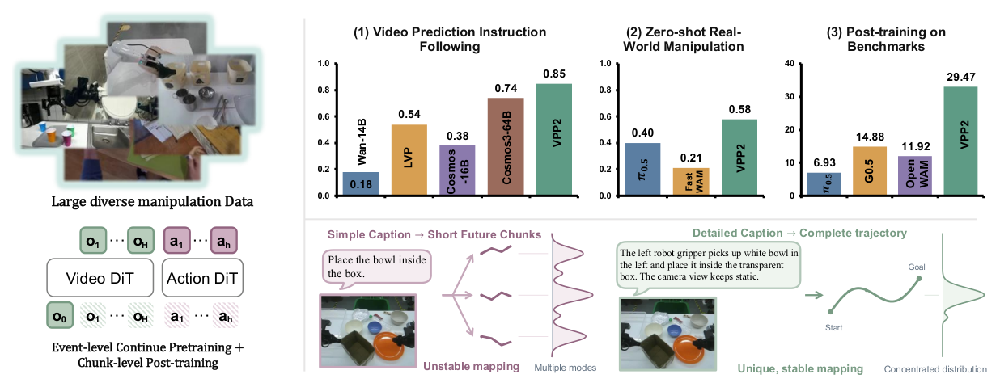
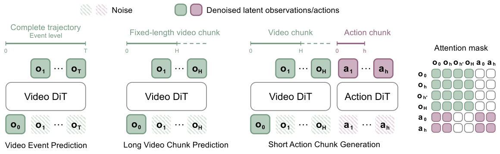
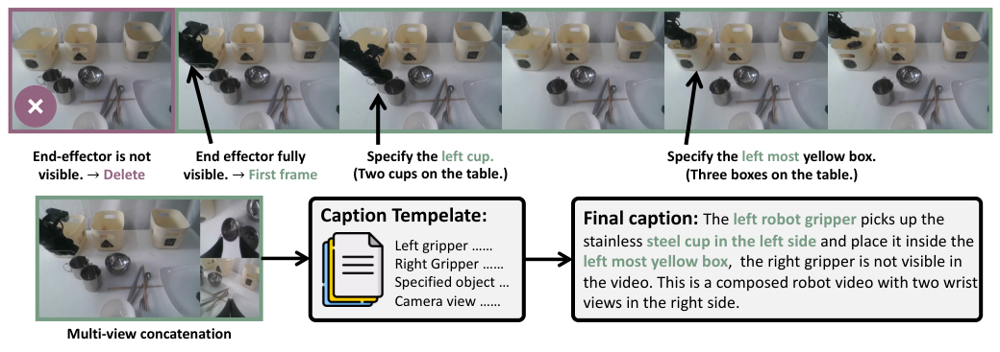

# VPP2 详解教程：先预测对，再动得对

> 论文：Yanjiang Guo 等，*Video Prediction Policy 2: Predict Better, Act Better*，arXiv:2610.10270v2，2026。作者机构包括 Robotera、清华大学、香港科技大学（广州）、UC Berkeley、上海交通大学。本文依据 [论文 PDF](../papers/video-prediction-policy-2/paper.pdf)、[LaTeX 正文](../papers/video-prediction-policy-2/paper.tex) 与 [官方代码](https://github.com/roboterax/video-prediction-policy-2)（查阅日期：2026-10-13）。论文仍是预印本，首页模板指向 ICLR 2027，不能据此写成已录用。

## 导读地图

| 站 | 学完能回答的问题 | 论文依据 |
| --- | --- | --- |
| ① 动机 | 为什么“视频生成得好看”仍会让机器人做错？ | 图 1、§1 |
| ② 架构 | 视频 DiT 和动作 DiT 怎样相连？ | 图 4、§3 |
| ③ 训练 | 三个阶段分别在学什么？ | §3.1–3.2、式 1–5 |
| ④ 数据 | 一条样本是什么，跨机器人如何对齐？ | 图 2–3、§2、附录 A |
| ⑤ 信息流 | 一次观察怎样变成动作块？ | §3、官方 `vpp2.py` |
| ⑥ 走例子 | “把左边的杯子放入盒子”如何跑两轮？ | 图 2、代码；数值示意 |
| ⑦ 实验 | 哪些结论受到评测设置限制？ | 图 8、表 2–4 |

## 基本情况：一句话抓住论文

给定当前相机画面、机器人状态和文字子任务，VPP2 用视频模型形成未来视觉表示，再让动作专家输出下一段连续动作。它从 Wan2.1-I2V-14B 出发，先学习**完整操作事件**的视频预测，再学习**固定时间长度**的视频预测并做单步蒸馏，最后接上动作 DiT。核心假设是：未来视觉轨迹如果更符合指令，逆动力学映射就更容易给出正确动作。[论文 §1–3](../papers/video-prediction-policy-2/paper.tex)

开源情况：官方仓库提供视频推理、LIBERO/RoboDojo 训练与评测代码，Hugging Face 提供部分视频及基准策略权重；大规模事件级预训练的完整数据和训练配方没有随仓库完整公开。代码仓库 README 也明确说 LIBERO 的精确前置初始化和训练数据尚待发布。可做公开基准复现，但不应把“能运行某个基准”理解为“能从零重现论文全部结果”。[官方仓库](https://github.com/roboterax/video-prediction-policy-2)

## ① 动机：为什么要先修视频预测

想象指令“把左边的白碗放进透明盒”。画面上可能有两个白碗、两只机械手。若只给一句宽泛的“放碗”，短动作块的监督会混入多条合理轨迹，视频模型也可能把右手或右边的碗当成目标。机器人即使精确执行由错误未来画面引出的动作，也会失败。

作者指出两个症结：通用视频模型重视视觉生成质量，未必准确遵守操作指令；直接加入动作训练又可能破坏原有的视频泛化。VPP2 的押注是：用明确的对象、末端执行器和完整事件边界，先让“指令 → 视频轨迹”更稳定，再学习“未来视觉表示 → 动作”。这里的“稳定”是作者的方法动机，并不意味着场景从此只有一条合法轨迹。[图 1](../papers/video-prediction-policy-2/figures/fig-01.png)、[§1](../papers/video-prediction-policy-2/paper.tex)



图 1 左侧是大规模操作数据及三项主要结果，中下部对比宽泛短动作描述和详细事件描述。读图重点是：详细 caption 指定目标和过程，事件级视频覆盖子任务的完整变化。

## ② 架构：两个专家共享上下文



图 4 从左到右读：第一列训练完整事件视频，第二列把不同事件压到固定时间窗，第三列用视频 DiT 的视觉 token 条件化动作 DiT。右侧注意力矩阵里，视频 token 可以看视频 token，动作 token 可以看被允许的视频 token 和动作 token；这不是先把视频解码成 RGB，再通过另一个视觉编码器读取的串行结构。

| 模块 | 输入 → 输出 | 作用与训练状态 |
| --- | --- | --- |
| Wan2.1-I2V-14B 视频 DiT | 初始图像、文本、带噪视频 latent → 未来视频 latent / 中间表示 | 事件级续训、固定窗后训练、蒸馏；动作初期冻结主干，仅用 LoRA 适配。论文 §3。 |
| 视频 VAE、CLIP、UMT5 | RGB/文本 → 视频 latent、图像和文本条件 | 公共视频输入编码器；官方基准包还要求这些共享权重。 |
| Action DiT | 带噪动作、文本/本体状态、视频缓存 → 动作流速度 | 论文通用描述是新初始化的约 0.9B 参数专家；具体 RoboDojo 发布配置使用 Action2B。 |
| MoT 注意力 | 视频 token 与动作 token → 共享信息 | 独立参数的两条 transformer 分支通过注意力交互；动作端读取视频缓存。 |
| 可选 VLM 规划器 | 长指令和执行反馈 → 明确子任务 caption | 长任务拆段、补足目标/末端/视角描述；论文表 4 的 RoboDojo 主结果未使用该规划器。 |

**接口数值要按场景分开：**论文的通用机器人视频阶段是 17 帧、416×240、8 秒预测窗；图 4 给动作块 2 秒。论文称单步视频约 0.12 秒，动作 5 次去噪约 0.1 秒，合计约 0.22 秒/块。官方 LIBERO 配置则使用 32×7 动作、10 次 Euler 步、执行前 10 步再重算；RoboDojo 用 32×16、10 步、执行前 24 步，另有 8 帧历史。这些不是同一个统一的控制频率或唯一部署设置。[论文 §3.2](../papers/video-prediction-policy-2/paper.tex)、[LIBERO 指南](https://github.com/roboterax/video-prediction-policy-2/blob/main/docs/libero.md)、[RoboDojo 指南](https://github.com/roboterax/video-prediction-policy-2/blob/main/docs/robodojo.md)

## ③ 训练：从长事件到固定窗，再到动作

### 阶段 1：完整事件的视频 flow matching

数据处理先把示教切成语义完整的 1–12 秒片段。对于一段从 `o₀` 到 `o_T` 的操作事件，均匀抽取 `N` 个未来帧，加上初始条件帧。不同事件可以持续不同时间，但每个训练目标都尽量覆盖“这个子任务从开始到结束”。视频编码器将帧变成干净 latent `x₁`，随机噪声为 `ε`，训练时在二者之间取点：

```text
xₛ = (1 − s)ε + sx₁,   s ∈ [0,1]
L_FM = E[‖vθ(xₛ, s, c) − (x₁ − ε)‖²]
```

`c` 是初始画面和详细子任务文字；`vθ` 预测从噪声走向目标视频 latent 的速度。**手算示意：**某一维 `ε=-1`、`x₁=3`、`s=0.25`，则 `xₛ=0`，正确速度为 `4`。若模型给 `3.5`，这一维平方误差就是 `0.25`。真实模型在高维 latent 上做同类计算。论文报告 49 帧、416×240，训练 30,000 步、batch 1,024、学习率 `1e-5`；`30,000×1,024` 是训练样本呈现次数，**不是独立片段数**。[论文 §3.1、式 1–3](../papers/video-prediction-policy-2/paper.tex)

### 阶段 2：固定时域后训练和单步蒸馏

事件级抽帧的时间间隔会随事件长短变化，不适合直接和固定长度动作对齐。作者因此改为从任意起点预测一个固定时间窗：人手数据 2 秒，机器人数据 8 秒。视频目标仍用同一 flow matching。随后用 consistency distillation 让学生模型在相邻流时间的输出指向同一个终点：

```text
L_CD = E[λ(s,s′) ‖Fθ(xₛ,s,c) − stopgrad(Fθ̄(x̂ₛ′,s′,c))‖²]
```

`x̂ₛ′` 来自冻结教师的一段积分；`θ̄` 是 EMA 学生。训练时有 50% 的概率取 `s′=1`，特别强化从纯噪声单次到终点的能力。推理时目标形式是 `Fθ(ε,0,c)`。注意“单步”指视频分支的蒸馏目标，不等于动作分支零去噪，也不等于所有发布基准都按完全相同的单步视觉路径运行。[论文 §3.1、式 4–5](../papers/video-prediction-policy-2/paper.tex)

### 阶段 3：动作专家

统一后的双臂动作提供监督。新建动作 DiT 时，作者先冻结视频 DiT 基础参数，仅用 LoRA 适配，减少动作梯度对视频表示的扰动。动作分支也对带噪动作做流式去噪，损失与视频预测损失可联合加权；代码在 [`src/vpp2/models/wan21_14b/vpp2.py`](https://github.com/roboterax/video-prediction-policy-2/blob/main/src/vpp2/models/wan21_14b/vpp2.py) 中计算 `loss_video`、`loss_action` 和总和。公开 LIBERO 复现路径更具体：先单独训视频，再冻结整条视频专家，只训动作专家和本体状态投影；RoboDojo 则有 joint Video + Action2B 训练。论文叙述、不同基准配方要各按对应配置理解。

## ④ 数据：一条样本到底长什么样



图 2 上方是一段操作被截成完整子任务；左下是主视角与两个辅助视角组成的 T 形拼图；右边的 caption 不只写“放杯子”，还写是哪只手、哪个杯子、哪个盒子及相机视角。若末端或目标第一帧看不到，管线会删掉或裁掉不合适的开头。[论文 §2、附录 A.1](../papers/video-prediction-policy-2/paper.tex)

| 字段 | 论文/代码中的形状或形式 | 例子与注意 |
| --- | --- | --- |
| 初始画面 | RGB；机器人通用视频阶段可拼 1–3 路相机 | 主相机画面，缺失辅助视角填黑。 |
| 详细 caption | 文本 | “左夹爪拿起左边不锈钢杯，放入最左侧黄色盒；右夹爪不可见”是图 2 的示例含义。 |
| 未来视频 | 阶段 1 为事件级 49 帧；阶段 2 为固定窗 17 帧 | 17 帧机器人窗覆盖约 8 秒；数据集具体采样节奏依配置。 |
| 本体状态 | 依机器人而异；LIBERO 示例 `[1,8]` | 只在公开基准配置下可固定为 8 维，不能推广到所有数据。 |
| 动作目标 | LIBERO `[32,7]`；RoboDojo `[32,16]` | LIBERO 前 6 维标为增量，第 7 维为 gripper；RoboDojo 为两臂各 `[xyz,qwxyz,gripper]` 的绝对 EE16。 |
| 有效位掩码 | 对尾部补帧/补动作分别标记 | 训练损失应排除 padding。 |

数据来自单臂、双臂、移动/人形机器人、人手第一视角和筛出的通用操作视频；论文称覆盖超过 20 种机器人 embodiment，双臂/第一视角类数据占总量 80% 以上。**论文没有给出可核查的总小时数、总片段数、各来源比例或完整公开数据包**，不要把来源清单当成数据规模。[表 1](../papers/video-prediction-policy-2/figures/tab-01.png)、[§2](../papers/video-prediction-policy-2/paper.tex)

跨数据集动作对齐用两个坐标变换：

```text
T̃_d = A_d · T_d · B_d
```

`T_d` 是某数据集原始末端位姿；`A_d` 将它的世界坐标对齐到规范工作空间；`B_d` 规范末端局部坐标。**示意：**数据集 A 把“向左 5 cm”记为 `+x`，数据集 B 记为 `−y`；对齐后才希望这两段视觉上相同的动作指向相近的规范坐标。实际 `A_d/B_d` 必须由机器人标定与数据定义计算，不能由示意数字直接取值。[图 3](../papers/video-prediction-policy-2/figures/fig-03.png)、[附录 A.2](../papers/video-prediction-policy-2/paper.tex)

## ⑤ 训练与推理的信息流

训练时，一条样本携带当前图像、caption、未来视频帧、机器人状态与动作轨迹。视频 VAE 编码未来帧；视频 latent 和动作各自加噪；视频 DiT 与动作 DiT 通过 MoT 交互；视频与动作损失对相应目标比较。事件级预训练还没有动作监督，动作阶段才需要配对动作。

```text
训练：图像 + 详细 caption + 未来帧 → 视频 latent + 噪声 → 视频速度损失
                            └─ 状态 + 未来动作 → 带噪动作 → 动作速度损失

推理：当前 RGB + 子任务文字 + 状态
      → 编码文本/第一帧 → 构造视频 latent 条件并预填 video KV cache
      → 随机动作 [H,D] → Action DiT 读取 video KV → Euler 更新，重复 K 次
      → 反归一化动作块 → 执行前 E 步 → 新观察 → 再调用
```

这里有一个读代码才容易发现的细节：公开基准的 [`infer_action`](https://github.com/roboterax/video-prediction-policy-2/blob/main/src/vpp2/models/wan21_14b/vpp2.py) 默认从视频 latent 噪声构造缓存，随后多轮更新的是**动作**；通常不需要把一段完整 RGB 视频先解码出来再用于控制。只有请求可视化时才额外返回单步/多步视频。因此“先预测视频、再做动作”应理解为利用视频模型的**预测表示**，不应画成每次控制都播放 8 秒视频。

## ⑥ 用一个具体例子走两轮

场景沿用图 2：“左夹爪拿起左侧不锈钢杯，放入最左侧黄色盒”。下述 `[32,7]` 采用公开 LIBERO 形状演示信息流；这句话来自论文数据示例，**并非声称它是 LIBERO 实际任务或公开真实样本**。动作数字只用于说明，单位和真实控制接口必须以机器人配置为准。

**t=0：**两路 224×224 RGB 拼成 `[3,224,448]`；图像编码器与文本编码器处理第一帧和详细子任务。本体状态是 `[1,8]`；动作从随机 `[32,7]` 开始。视频侧将条件与噪声视频 latent 送入 DiT，预填多层 video KV；动作侧在公开 LIBERO 配置下做 10 次 Euler 更新，得到 32 个 7 维动作。比如前一小段的示意增量是 `[+0.02,−0.01,+0.00,0,0,0,open]`，随后靠近杯口并闭合夹爪。系统只执行前 10 个动作，然后重新观测。[LIBERO 配置](https://github.com/roboterax/video-prediction-policy-2/blob/main/docs/libero.md)、[推理入口](https://github.com/roboterax/video-prediction-policy-2/blob/main/src/vpp2/models/wan21_14b/vpp2.py)

**t=1：**杯子可能略偏离预期。新的 RGB 和状态替换上一轮输入，重新建立与当前观测一致的视觉缓存，并重新采样一整块 `[32,7]` 动作；上一轮未执行的后 22 个动作不会被当作必须完成的开放环计划。系统再执行前 10 个动作。若任务仍未完成，这个闭环继续。缓存是在**一次推理内部**供多次动作去噪复用，不是跨所有控制轮次永远复用。

```text
观察当前杯位 → 编码图像/指令/状态 → 视频表示与缓存 → 动作去噪 10 轮
           → 输出 32 步 → 执行 10 步 → 再观察 → 更新动作块
```

## ⑦ 实验：读数字，也读口径

| 设置 | VPP2 | 对照与解读 |
| --- | ---: | --- |
| 视频指令遵循，100 个图像–指令对（人手 50、机器人 50） | 人手 0.80、机器人 0.90 | Cosmos3-64B 为 0.70、0.78。论文摘要的“高 11.0 个百分点”对应两组等权平均：0.85 对 0.74；不是每组都高 11 点。由 GPT 类评估器打分，另有人类成对比较。表 2、图 6。 |
| ALOHA 真实机器人 10 类未针对任务微调 | 平均 58.5% | π0.5 为 40.0%，Fast-WAM 为 20.5%。这里的 zero-shot 是**已见过的 ALOHA 机器人本体、未见任务**，且比较方法在相同 ALOHA 训练数据上微调。图 8。 |
| LIBERO-ID / Pro / OOD | 98.8% / 45.0% / 63.9% | 在标准四套 LIBERO 训练，再评估 Pro/OOD。表 3；是基准后训练结果，不是零微调迁移。 |
| RoboDojo-Sim | score 39.26、成功率 32.26% | 表 4；基准专门训练。比较基线取自 2026-09 官方排行榜，不全是同一论文内重跑。 |
| 五类选定 RoboDojo 任务的额外 VLM 子任务规划 | 27.6% → 57.6% | 每任务组 50 次；这是额外规划配置，不是表 4 的默认策略。图 9。 |

**能说的结论：**结果支持“更好的操作视频预训练可改善开放任务的视觉遵循，并与动作策略泛化有关”。**还不能单独证明：**提升全由事件级切分造成；表 2 的固定窗消融给出支持，但 caption、数据组合和后训练仍可能共同作用。没有总数据量、完整事件预训练配方和全量训练成本时，也难精确估算其他团队复现门槛。

## 应用到我的机器人：可执行的最小路线

1. 选一个有相似物体干扰的双臂桌面任务，如“拿左杯放入左盒”；先记录当前策略的成功率、错误对象选择率、视频目标偏移率。
2. 同步主视角与腕部视角、机器人状态、末端位姿和动作。保存相机时间戳、末端标定、工作空间变换，避免跨数据集动作符号冲突。
3. 把轨迹切成“拿起、移动、放下”之类的完整事件；caption 明确左/右手、目标物体、容器和相机变化。抽样人工核查误标与第一帧目标可见性。
4. 先在自家数据上对比“宽泛 caption + 固定窗”与“详细 caption + 完整事件”，量化目标物体跟踪、接触时刻和指令遵循。视频生成质量只看美观不够。
5. 若视频预测改善，再接动作专家，先冻结视频主干；用闭环执行和动作限幅评估。保持一个只用动作的基线，隔离视频表示带来的收益。

最低需要同步 RGB、语言标签、末端/关节状态、动作和坐标标定；复现 14B 主干及多阶段训练还需要高显存 GPU。预期收益是减少目标混淆、提升未见任务组合的动作选择；主要风险是错误视频先验误导动作、细 caption 标注成本高、跨本体坐标错配、缓存/推理延迟超出控制预算。论文没有给出适用于小型机器人的统一显存或训练小时估计，因此实际预算应先用一个小任务探测。

## 延伸阅读与材料

- [原始 PDF](../papers/video-prediction-policy-2/paper.pdf) · [PDF 转换 Markdown](../papers/video-prediction-policy-2/paper.md) · [图表索引](../papers/video-prediction-policy-2/figures/index.md)
- [英文分析](video-prediction-policy-2.md) · [中文分析](video-prediction-policy-2.zh-CN.md)
- [官方项目页](https://robert-gyj.github.io/video-prediction-policy-2) · [代码与权重入口](https://github.com/roboterax/video-prediction-policy-2)
