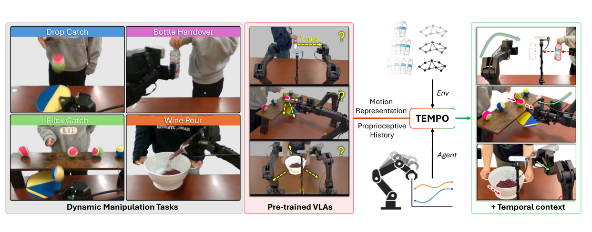
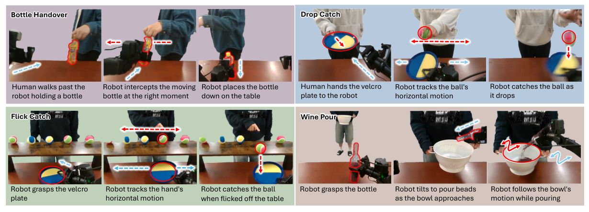

# 精读笔记 · TEMPO: Learning Temporal Context for Dynamic Robot Manipulation

> Zhenyang Feng、Jimin Heo、Erik B. Sudderth、Unnat Jain；UC Irvine；CoRL 2026；[论文](https://arxiv.org/abs/2609.16864) · [项目](https://tempo-robot.github.io/) · [官方代码](https://github.com/tempo-robot/TEMPO) · [TEMPO-Bench](https://github.com/tempo-robot/TempoBench)。核验于 2026-10-09。

## 基本情况与材料

给机器人当前多视角图像、指令、近期图像和过去的关节控制，输出下一段动作。论文在 π0.5 / VLASH 上增加运动和动作历史两路输入，研究真实双臂机器人如何抓住移动的目标。官方代码与 TEMPO-Bench 已公开；官方仓库的训练数据、训练好的策略权重及 YAM 部署项仍列为待发布。材料在本目录：`paper.pdf`、可读性更好的 `paper.md`、`paper.tex`、`source/`、`figures/`，以及仅本地检索的 `code/`、`benchmark/`。

| 站       | 核心问题                                 | 来源                    | 代码入口                                                 |
| -------- | ---------------------------------------- | ----------------------- | -------------------------------------------------------- |
| ① 动机   | 一张图为何不能指导动态操作               | 图 1、§1–3              | —                                                        |
| ② 架构   | TEMPO-MOT 与 TEMPO-ACT 怎样接进 π0.5     | 图 3、§4                | `code/src/openpi/models_pytorch/pi0_pytorch.py`          |
| ③ 训练   | 原有 flow matching、额外输入与两阶段微调 | §4.3、附录 B.3          | `pi0_pytorch.py:585-650`、`training/config.py`           |
| ④ 数据   | 一条双臂接瓶样本及时间窗口               | 图 4、TEMPO-Bench       | `training/data_loader.py`、`policies/yam_dual_policy.py` |
| ⑤ 信息流 | 一次推理里哪些缓存、哪些反复计算         | §4.4、表 3              | `pi0_pytorch.py:652-710`                                 |
| ⑥ 例子   | 用公开接瓶轨迹走两次观测                 | TEMPO-Bench 第 0 条轨迹 | `benchmark/data/dynamic_handover/`                       |
| ⑦ 实验   | 成功率、速度、消融与边界                 | 表 1–7                  | —                                                        |

## ① 动机



图 1 左侧列出接落球、接瓶、接弹球、倒珠子四项任务；中间显示只看当前画面的预训练 VLA 会错过运动方向和任务阶段；右侧展示补入运动表征和机器人自身历史后的操作。**问题一，运动歧义**：人拿着瓶子从左向右走，单张照片只给位置，不给速度；等机器人伸手时瓶子已离开原位。**问题二，状态别名**：夹爪在瓶旁的画面，可能是刚伸过去要抓，也可能是倒完后要松开撤回；同一幅图需要相反动作。缩短推理延迟有帮助，却无法从单帧恢复这两种缺失信息。

作者的押注是：保持已有 VLA，额外提供“场景最近怎样动”和“机器人最近做过什么”，让策略自己学习何时追踪、何时切换任务阶段。论文用单信号消融检查这两项是否互补，而非仅给一个更大的网络。

## ② 架构


图 3 下方有两条输入：紫色路径从历史视觉特征生成运动信息，橙色路径把历史控制聚为时间桶。上方 VLM 处理图像、指令和时间条件；右侧 action expert 从噪声生成动作。另一条 `UVT` 输出头是独立扩展实验，不是 TEMPO 的必要部件。

**TEMPO-MOT**：论文写作 `mₜ=CrossAttn(fₜ,Fₜ)`，当前帧 patch 作为 query，历史帧特征缓存作为 key/value；默认使用冻结的 SAM 2.1 Tiny。代码的参考配置更具体：每相机取 3 帧（含当前帧），相邻约 0.333 秒，SigLIP 每 4 层做一次时间注意力；同时读取当前帧 SAM2 memory-attention 的 `64×256` 特征，用零门控 cross-attention 融进 head 相机当前视觉 token。SAM2 本身冻结。代码里是**融合进视觉 token**，不是简单追加一个独立 motion token；这与论文图示的抽象接口有差别。

**TEMPO-ACT**：在 30 Hz 下取过去 300 条原始控制，每 30 条求均值，得到 `10×A`。双臂 `A=14`（每臂 6 个关节和 1 个夹爪），单臂为 7。十个向量作为 VLM 的额外前缀 token；展平后另经 MLP 加到 action expert 的 AdaRMS 条件。越出 episode 起点的动作补零，整桶越界时置 pad 标志。

| 模块                       | 来源及训练           | 输入 → 输出                               | 作用               |
| -------------------------- | -------------------- | ----------------------------------------- | ------------------ |
| π0.5 / VLASH               | 预训练底座，任务微调 | 当前多视角图、语言、状态 → 动作流         | 基本策略与异步执行 |
| SAM 2.1 Tiny               | 冻结                 | head 相机视频 → 当前 `64×256` 运动特征    | 提供场景运动线索   |
| 视觉时间注意力与 SAM2 融合 | 新增、可训练         | 3 帧视觉特征 + SAM2 特征 → 当前视觉 token | 把运动信息给 VLM   |
| 动作历史投影及 AdaRMS 路径 | 新增、可训练         | `10×A` → 前缀 token 和去噪条件            | 区分任务阶段       |

论文称新增约 2M 参数、0.08%；这是新增路径相对底座的规模，不包含冻结 SAM2 的总参数。代码的 SAM2 融合和 AdaRMS 残差是零初始化；**十个动作历史前缀 token 会改变序列，不能保证完整模型在初始化时与原策略逐位相同**（`training/config.py:1239-1253` 的注释也明确说明）。

## ③ 训练与损失

TEMPO 不另加“运动标签损失”或“阶段分类损失”，仍用 π0.5 的动作 flow matching；两个时间模块靠动作监督学会提供有用条件。代码约定 `s=1` 是高斯噪声、`s=0` 是真实动作：

```text
xₛ = s ε + (1−s) a*          目标速度 u = ε − a*
L = E ‖ vθ(xₛ, 当前图像, 指令, 运动特征, 动作历史, s) − u ‖²
推理：从 x₁=ε 出发，沿 s 从 1 到 0 做 10 次 Euler 更新。
```

`a*` 是归一化后的目标动作块；`ε` 同形噪声；`xₛ` 是带噪块。**示意数字**：单维真实目标 `0.8`、噪声 `−0.2`、`s=0.25`，则输入为 `0.55`、正确速度 `−1.0`；若模型给 `−0.7`，平方误差 `0.09`。这种条件生成允许同一情境存在多条合理动作轨迹，避免把相反动作简单平均成一个犹豫的中间值。

官方配置给出 π0.5 底座训练 10,000 步、TEMPO 增量配置 5,000 步，batch 128、AdamW 峰值学习率 `5e−5`；后者可以从已有运动路径 checkpoint 热启动。论文附录 B.3 报告每策略约 2 小时、8 张 RTX PRO 6000 Blackwell。代码 `pi0_pytorch.py:585-650` 生成 `xₛ`、目标速度和 MSE；`:652-710` 在推理中重复 10 次去噪。`TEMPO+UVT` 改变输出目标为单个 64 维 latent 并用独立解码器还原动作，不应把其表 4 结果归因于 TEMPO 输入本身。

## ④ 数据：一条真实记录



图 4 按时间展示四项真机任务。论文没有公布每项训练演示的总条数；[TEMPO-Bench](https://github.com/tempo-robot/TempoBench)公开的是便于运动探测的机器人录像和物体标注，**不能把其规模当作策略训练集规模**。公开基准含 257 段、97,265 帧，其中 55,482 帧有可见物体定位；视频由 Git LFS 管理。以下是真实的 `dynamic_handover` 第 0 段第 60 帧（2.000 秒），由本地 Parquet 读取：

| 字段                | 形状 / 单位                          | 实际值或说明                                                                 |
| ------------------- | ------------------------------------ | ---------------------------------------------------------------------------- |
| 任务文字            | 字符串                               | `dynamic handover`                                                           |
| 图像                | head、left_wrist、right_wrist，30 Hz | 原始 head 标注坐标系 `640×480`；策略输入约 224p；本地 Git LFS 视频未拉取像素 |
| `observation.state` | `14`，双臂 6 关节+夹爪各一组         | 前 4 维 `[-0.03567, 1.13432, 1.06107, 0.04101]`，其余 10 维在 Parquet 中     |
| `action`            | `14`，下一步原始关节目标             | 前 4 维 `[-0.04141, 1.16197, 1.05946, 0.05622]`；不是模型预测输出            |
| `object.position`   | head 图像 `(x,y)` 像素               | `[237.095, 200.553]`                                                         |
| `object.velocity`   | `(vx,vy)` 像素/秒                    | `[487.380, −56.580]`，数据集跟踪标注                                         |

前 300 条**原始**动作在第 60 帧只实际存在 60 条：前 8 桶全 pad，第 9 桶是第 0–29 帧、第 10 桶是第 30–59 帧。按官方 `LoadActionHistory` 公式重算，最后两桶前四维均值分别为 `[-0.0242,1.1011,1.0693,0.0179]` 和 `[-0.0361,1.1117,1.0494,0.0303]`。这是历史条件，不经过动作目标的归一化。训练目标另取当前起 16 条动作；YAM 数据变换默认将前 6 个关节目标改成相对当前状态的增量、夹爪保持绝对值，再归一化并 pad 到模型内部 `16×32`。最终输出切回本体原生 `16×14`（单臂 `16×7`）。

## ⑤ 输入输出信息流

```text
训练：LeRobot 录像/Parquet → 当前与前两帧图像、状态、16×A 动作、过去300动作
      冻结 SAM2 → 当前 64×256；历史动作 → 10×A；图像/文字/两路条件 → VLM 前缀
      真实动作加噪 → action expert 预测速度 → flow MSE

推理：3 路相机当前与前两帧（间隔约0.333秒） ─┐
      head 相机 SAM2 流式缓存 → 64×256 ───────┼→ VLM 前缀 / KV cache（每次调用一次）
      指令、当前状态、过去10秒动作 → 10×A ───┘
      高斯噪声 16×32 → action expert ×10 次 → 动作 16×32
      反归一化、去 padding、关节增量还原 → 原生 16×A → 异步执行 → 新观测
```

视频编码在独立线程运行；论文报 SAM2 每帧约 11 ms，策略中位前向 35.3 ms，对照 VLASH 33.8 ms、RTC 127.7 ms。相机标称 30 Hz，但 35.3 ms 大于一帧的 33.3 ms，故**不能仅凭这个延迟表保证每轮同步达到 30 Hz**；异步执行解决控制等待。模型的 16 步块若逐步按 30 Hz 执行，对应约 0.53 秒，具体重规划/块衔接由 VLASH 异步部署决定，论文没有给出固定“执行完 16 步才重算”的规则。

## ⑥ 接瓶例子：两次观测

先用玩具尺寸理解：若单路运动只记水平方向、两次画面中瓶子位置从 `x=0.2` 到 `x=0.3`，相隔 `0.1` 秒，速度约 `+1.0` 单位/秒。策略除了当前位置，还知道“往右走”；过去动作 `[伸手,伸手,夹紧]` 又告诉它当前接近抓取阶段。这些玩具数值仅说明算法，不是实验轨迹。

**第 0 次调用（公开第 0 段第 50 帧，1.667 秒）**：基准数据里的瓶子中心 `(91.218,211.676)` 像素，跟踪速度 `(467.850,−95.460)` 像素/秒。代码在此时读最近 3 帧图像，SAM2 提供 `64×256` 特征，`LoadActionHistory` 聚合此前的原始控制，生成 `10×14` 历史。VLM 结合 `dynamic handover` 指令与当前状态，只做一次前缀编码；action expert 对内部 `16×32` 噪声做 10 轮速度预测，输出原生 `16×14` 控制块。**这一段模型输出是流程说明，公开 Parquet 只提供示范者记录的动作，没有 TEMPO 权重可复算预测值。**

**第 1 次调用（第 60 帧，2.000 秒）**：公开记录中瓶子已到 `(237.095,200.553)`，速度标注 `(487.380,−56.580)` 像素/秒。相较第 50 帧，瓶子向右约 146 像素。过去 10 秒的动作桶加入第 50–59 帧已执行的控制，新 head 图像与 SAM2 缓存进入下一次前缀计算。模型因此可以改变预期截取位置及夹爪时机；是否真的这样改，要有训练权重及部署轨迹才能证实。实际闭环是 `观测 → 运动缓存/动作桶 → 前缀 → 10 次动作去噪 → 异步执行 → 新观测`。

对应代码：`training/data_loader.py:145-160` 抽 3 帧；`policies/yam_dual_policy.py:46-124` 载入 SAM2 与原始动作历史；`models_pytorch/pi0_pytorch.py:335-403,416-485` 插入两路条件；`:585-710` 训练速度场并采样动作。

## ⑦ 实验、地位与限制

| 实验设置                         | 对比                                    | 结论                                           |
| -------------------------------- | --------------------------------------- | ---------------------------------------------- |
| Bottle Handover，真机 50 次      | VLASH 38%、RTC 44%、TEMPO 74%           | 运动与历史输入改善接移动瓶子（表 4）           |
| Drop Catch，真机 50 次           | RTC 80%、TEMPO 66%                      | 反应时序主导时 TEMPO 并非最佳（表 4）          |
| 原始完整 Flick Catch / Wine Pour | 两个异步基线均 0%；TEMPO 为 68% / 97.6% | 历史能区分伸手与释放/撤回阶段（表 1）          |
| Bottle Handover 单信号消融       | 仅 ACT 52%、仅 MOT 56%、两者 74%        | 两种时间信息互补（表 6）                       |
| TEMPO+UVT                        | 四任务平均 87.2%，TEMPO 单独 76.0%      | 更换输出目标还能带来收益，属另一个改动（表 4） |

**比较口径：**表 4 的 Flick Catch 和 Wine Pour 是去掉“释放并撤回”阶段的裁剪任务，原始完整任务的数值在表 1；Wine Pour 的百分数是倒入容器的珠子质量比例，而非二值成功率。TEMPO-Bench 的 `55,482` 帧有可见物体定位，`97,265` 是全部帧数；不可混称。冻结 SAM2 的在线编码仍要算，约 2M 新增参数也不代表整个系统只有 2M 参数。代码和数据尚缺公开策略权重，无法独立复算论文真机成功率；任务演示规模也未在论文中充分量化。

## 问题分析

本次问题为按 kelip-paper-reading 完整分析 TEMPO；上面七站已覆盖论文、代码与公开基准数据。后续针对本文的具体问题追加于此。

## 代码与论文之间要核对的地方

1. 论文图 3 把运动表示为 VLM 新 token；官方实现是 3 帧 SigLIP 时间注意力，加冻结 SAM2 `64×256` 特征融合进 head 视觉 token（`training/config.py:1239-1245`、`pi0_pytorch.py:335-365`）。因此“完全不修改 backbone”应理解为尽量保留预训练主体和接口，不能按字面说代码未改视觉编码器。
2. 论文说新增路径零初始化以保留初始策略；官方代码明确标注 ACT 的 10 个前缀 token 会改变序列，只有 SAM2 融合和 AdaRMS 残差严格零影响（`training/config.py:1249-1253`）。
3. 论文正文对 YAM 动作称原始关节位置 chunk；官方数据接口是原始关节目标，默认把关节维度转成 delta 后训练，夹爪保持绝对，推理再还原。不能把 Parquet 中的 `action` 直接当作 flow target。

## 应用到我的机器人

- **集成思路：** 在现有 VLA 上先加原始控制日志的 10 桶均值，做单独消融；再用冻结视频编码器输出流式运动特征，评估两者叠加。分别统计截取移动目标失败和任务阶段误判。
- **传感器与算力：** 需要带时间戳的 RGB、关节及夹爪状态、已发控制和异步执行记录；部署需视频编码器与 VLA 的 GPU。论文训练每策略使用 8 张 RTX PRO 6000 Blackwell。
- **预期收益：** 提升对运动目标的提前定位，减少伸手、夹紧、撤回阶段的反向控制。
- **风险：** 物体遮挡与视频延迟会污染运动线索，10 桶平均会抹平快速动作；换本体时要重新定义 14 维/7 维控制语义。先在安全任务里逐项验证。
